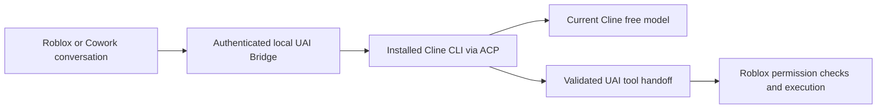

# Cline through UAI Bridge

Project UAI 3.7.0 adds a **Tunnels** page to the Windows bridge and Cowork web
UI. Cline runs as a separately installed local CLI. Its current free promotional
models can serve a UAI conversation through that bridge; Roblox continues to own
the conversation, tool execution, permissions and Stop button.

Cline requires an account. Its [free-model guide](https://docs.cline.bot/getting-started/free-models)
states that promotions are available through the CLI and IDE, rather than its
public API. UAI uses the official [ACP interface](https://docs.cline.bot/usage/acp)
over the local process's standard input/output. It does not copy login tokens
into provider settings or proxy an undocumented account API.

## Set up on Windows

1. Install Cline using Node.js/npm:

   ```powershell
   npm install -g cline
   ```

2. Sign in through Cline:

   ```powershell
   cline auth cline
   ```

   Complete Cline's normal account sign-in. The bridge reports **Sign in required**
   until authentication is available. It lets the native CLI read its saved
   provider settings; login tokens are not copied into UAI.

   If `%LOCALAPPDATA%\Project UAI\cline\data\settings\providers.json` exists,
   that dedicated profile is preferred. Otherwise the bridge uses the standard
   `%USERPROFILE%\.cline\data\settings\providers.json`. In both cases, UAI
   creates private configuration, MCP settings and workspaces for its requests.

3. Open **UAI Bridge > Tunnels**, enable Cline while the bridge is stopped, and
   start the bridge. Keep the CLI installed; it is not bundled in the executable.
4. In Roblox or Cowork, add **Cline (Bridge)** from the provider gallery, fetch
   models, and choose a returned free model. Keep authentication set to **None**.
   The local CLI owns the account sign-in.

The Windows Tunnels page checks installation before Cowork starts. Use
**Refresh installed apps** after installing OpenCode or Cline. This check only
locates native executables; it does not start either CLI or open sign-in.
If Node.js is missing, the page shows **Not checked** with setup guidance.
**Installed** means the executable was found; account and model access are
checked separately when the bridge starts.

Cowork's **Tunnels** page shows connection status and a **Free models** action
with copyable model IDs. Refresh the model list after signing in or when a
promotion changes. Restart the bridge if its installed CLI was updated.

## Routing and tool ownership



The provider's `https://uai-tunnel.invalid/cline/v1` address is a reserved routing
marker. The bridge handles it internally; it is never an outbound provider URL.
Without a connected compatible bridge, the request fails with setup guidance.
The Android companion and direct executor HTTP do not provide this Cline route.

The bridge checks Cline's current free catalog before admitting a model. A
missing, paid or expired selection fails; it does not silently switch to a paid
model. Ordinary account quotas, promotions and service availability still apply.

Requests use private workspaces and MCP configuration. Cline's own host file,
terminal and browser tool requests are denied. UAI tool calls are validated and
returned to Roblox for the normal approval/execution flow. Stop cancels the
owned CLI work; partial responses and uncertain outcomes are not replayed as a
new request. Sign-in state remains in the original local Cline profile.

This Cline adapter currently accepts text conversations only. Inspection of CLI
3.0.73 found that its ACP prompt handler drops image blocks despite advertising
image support, so UAI rejects image input explicitly instead of silently losing
the attachment. Use a vision-capable direct provider or Kilo route for screenshots.

Sampling and reasoning effort follow Cline's CLI defaults. This adapter does
not forward the generic UAI temperature or reasoning-effort options to Cline.

## Free model catalog

On October 25, 2026, Cline's source-documented
[recommended-model catalog](https://api.cline.bot/api/v1/ai/cline/recommended-models)
listed these free promotions:

- `reflection/beam-free`
- `cline-free/nemotron-3.5-super-vl`
- `nvidia/nemotron-3.5-lightning-free`
- `poolside/laguna-s-2.1-free`
- `cline-free/solar-mini4`

The authenticated CLI's generic model catalog omits these promotional IDs. The
bridge follows Cline's own promotion list and native explicit-model resolver,
then verifies the exact model ID, Cline provider and disabled automatic host-tool
approvals before prompting. It never substitutes a similarly named paid model.
Treat the list above as a dated snapshot, not guaranteed availability or a
benchmark ranking. Fetch the live list in UAI before selecting a model.

Set `UAI_CLINE_DISABLED=1` before starting a terminal bridge to disable Cline.
`UAI_CLINE_BINARY` can select an absolute path to an installed native CLI.

## Verified with Cline 3.0.73

The installed CLI accepted the existing account and exposed five current free
promotions. A real `reflection/beam-free` request returned HTTP 200 and the
requested text. A second request returned the complete two-tool batch through
the private MCP handoff; no Roblox actions were executed by this smoke test.
Both owned sessions and their temporary files were removed. Twelve native
process/HTTP fixtures cover authentication errors, model selection, host-tool
denial, Unicode streaming, cancellation, bounded input and cleanup.

For anonymous Kilo recovery and recommended Kilo models, see
[Kilo tunnel](KILO_TUNNEL.md). Build and runtime evidence is recorded in
[3.7.0 verification](TESTING_3.7.0.md).
