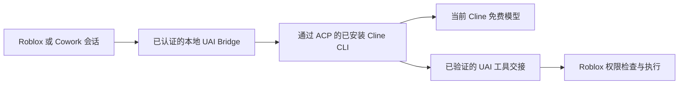

# 通过 UAI Bridge 使用 Cline

Project UAI 3.7.0 为 Windows 桥接和 Cowork Web
UI 增加了 **隧道** 页面。Cline 作为单独安装的本地 CLI 运行。其当前的免费促销
模型可以通过该桥接为 UAI 会话提供服务；Roblox 仍然掌管
会话、工具执行、权限和停止按钮。

Cline 需要一个账号。其[免费模型指南](https://docs.cline.bot/getting-started/free-models)
说明促销可通过 CLI 和 IDE 使用，而不是其
公共 API。UAI 通过本地进程的标准输入/输出使用官方 [ACP 接口](https://docs.cline.bot/usage/acp)。
它不会把登录令牌
复制到提供商设置中，也不会代理未文档化的账号 API。

## 在 Windows 上设置

1. 使用 Node.js/npm 安装 Cline：

   ```powershell
   npm install -g cline
   ```

2. 通过 Cline 登录：

   ```powershell
   cline auth cline
   ```

   完成 Cline 的常规账号登录。在认证可用之前，桥接会报告 **需要登录**。
   它允许原生 CLI 读取其已保存的
   提供商设置；登录令牌不会被复制到 UAI。

   如果 `%LOCALAPPDATA%\Project UAI\cline\data\settings\providers.json` 存在，
   则优先使用该专用配置文件。否则桥接使用标准的
   `%USERPROFILE%\.cline\data\settings\providers.json`。在两种情况下，UAI
   都会为其请求创建私密配置、MCP 设置和工作区。

3. 打开 **UAI Bridge > 隧道**，在桥接停止时启用 Cline，然后
   启动桥接。请保持 CLI 已安装；它不会打包进可执行文件。
4. 在 Roblox 或 Cowork 中，从提供商库添加 **Cline (Bridge)**，获取
   模型，并选择一个返回的免费模型。保持认证设置为 **None**。
   账号登录由本地 CLI 掌管。

Windows 的隧道页面会在 Cowork 启动前检查安装情况。安装 OpenCode 或 Cline 后，请使用
**刷新已安装应用**。该检查只
定位原生可执行文件；它不会启动任一 CLI 或打开登录。
如果缺少 Node.js，页面会显示 **未检查** 并给出设置指引。
**已安装** 表示找到了可执行文件；账号和模型访问会在桥接启动时
单独检查。

Cowork 的 **隧道** 页面显示连接状态和一个 **免费模型** 操作，
其中包含可复制的模型 ID。登录后或促销变化时，请刷新模型列表。
如果已安装的 CLI 已更新，请重启桥接。

## 路由与工具归属



提供商的 `https://uai-tunnel.invalid/cline/v1` 地址是保留的路由
标记。桥接在内部处理它；它从来不是出站提供商 URL。
没有连接兼容的桥接时，请求会失败并给出设置指引。
Android 伴随端和执行器直接 HTTP 不提供此 Cline 路由。

桥接在接纳模型之前会检查 Cline 当前的免费目录。缺失、付费或已过期的选择会失败；它不会静默切换到付费
模型。普通账号配额、促销和服务可用性仍然适用。

请求使用私密工作区和 MCP 配置。Cline 自身对宿主文件、
终端和浏览器工具的请求会被拒绝。UAI 工具调用会被验证并
返回 Roblox，走正常的批准/执行流程。停止会取消其
拥有的 CLI 工作；部分响应和不确定的结果不会作为
新请求重放。登录状态保留在原始的本地 Cline 配置文件中。

此 Cline 适配器目前只接受文本对话。对 CLI
3.0.73 的检查发现，其 ACP 提示处理器尽管声称支持
图片，却会丢弃图像块，因此 UAI 会显式拒绝图像输入，而不是静默丢失
附件。截图请使用支持视觉的直接提供商或 Kilo 路由。

采样和推理强度遵循 Cline 的 CLI 默认值。此适配器
不会把通用的 UAI 温度或推理强度选项转发给 Cline。

## 免费模型目录

2026 年 10 月 25 日，Cline 源码中记录的
[推荐模型目录](https://api.cline.bot/api/v1/ai/cline/recommended-models)
列出了以下免费促销：

- `reflection/beam-free`
- `cline-free/nemotron-3.5-super-vl`
- `nvidia/nemotron-3.5-lightning-free`
- `poolside/laguna-s-2.1-free`
- `cline-free/solar-mini4`

已认证 CLI 的通用模型目录省略了这些促销 ID。桥接
遵循 Cline 自身的促销列表和原生显式模型解析器，
然后在发起提示前验证确切的模型 ID、Cline 提供商和自动宿主工具批准已禁用。
它绝不会替换为名称相似的付费模型。
请将上面的列表视为带日期的快照，而非保证的可用性或
基准排名。选择模型前，请在 UAI 中获取实时列表。

启动终端桥接前设置 `UAI_CLINE_DISABLED=1` 可禁用 Cline。
`UAI_CLINE_BINARY` 可以选择已安装原生 CLI 的绝对路径。

## 已用 Cline 3.0.73 验证

已安装的 CLI 接受了现有账号，并公开了五个当前免费
促销。一个真实的 `reflection/beam-free` 请求返回 HTTP 200 和
所请求的文本。第二个请求通过私密 MCP 交接返回了完整的两工具批次；
此冒烟测试未执行任何 Roblox 操作。
两个拥有的会话及其临时文件均已被移除。十二个原生
进程/HTTP 测试夹具覆盖认证错误、模型选择、宿主工具
拒绝、Unicode 流式传输、取消、有界输入和清理。

关于匿名 Kilo 恢复和推荐的 Kilo 模型，见
[Kilo 隧道](KILO_TUNNEL.md)。构建和运行时证据记录在
[3.7.0 验证](TESTING_3.7.0.md)。
