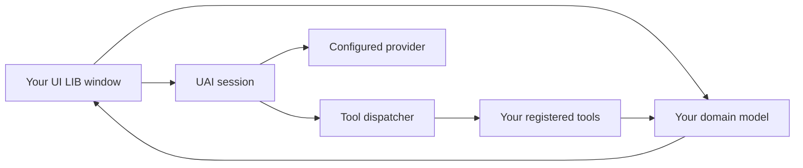

# 嵌入 Project UAI

使用 Project UAI UI LIB 构建脚本接口、把 UAI 添加到宿主脚本，或把你自己的库窗口连接到 UAI 的会话与工具。本指南记录 **Project UAI 3.7.2（2026 年 10 月 29 日）** 中的 **嵌入 SDK 1.0.0**，以及与 **UI LIB 1.4.0** 的配套关系。SDK 元数据通过 `uai.sdk` 暴露；UI LIB 仍然是独立的包，拥有自己的版本与生命周期。

3.7.2 客户端初次启动时要求设置密码，或明确选择 **不加密继续**。保险库在每次执行时都需要解锁，包括复用与 `{ ui = false }` 嵌入。已保存的「非受保护存储」选择会跳过后续提示，并以可逆的字节编码保存密钥。`sdk.features.passwordGate` 为 true，`uiFreeBoot` 为 false：正常应用可以保持隐藏，但加载器仍可构造入口 UI。宿主集成仍然拥有自己的作用域与清理；在派发工作之前，请检查返回的准入状态。参见[发布说明](../CHANGELOG.md)
与[针对性验证记录](TESTING_3.7.2.md)。

从[完整工作台示例](../examples/embedding/README.md)开始可获得可运行的代码。
使用 [UI 库参考](UI_LIBRARY.md)了解每个控件、窗口选项、配置方法与清理方法。
本文说明这些部件如何组合成一个应用，包括独立 UI 库不提供的运行时 API。

- [选择集成方式](#choose-an-integration)
- [宿主与前置条件](#hosts-and-prerequisites)
- [加载与复用包](#load-and-reuse-the-bundles)
- [宿主上下文](#host-context)
- [客户端句柄](#client-handle)
- [SDK 快速开始](#sdk-quickstart)
- [会话](#conversations)
- [请求](#requests)
- [事件与渲染](#events-and-rendering)
- [自定义工具](#custom-tools)
- [权限与工具作用域](#permissions-and-tool-scope)
- [钩子](#hooks)
- [提供商与客户端配置](#providers-and-client-configuration)
- [构建你自己的 UI](#build-your-own-ui)
- [文件与桥接图像](#files-and-bridge-images)
- [所有权与关闭](#ownership-and-shutdown)
- [仓库扩展](#repository-extensions)
- [分发与验证](#distribution-and-verification)
- [故障排查](#troubleshooting)

## 选择集成方式

| 目标 | 加载 | 你的代码负责 | UAI 负责 |
| --- | --- | --- | --- |
| 设置面板、玩家选择器或脚本工作台 | `dist/uai-ui.lua` | 领域状态、回调、订阅 | 窗口、控件、布局、输入、动效、清理作用域 |
| 把标准助手加入已有的宿主脚本 | `dist/uai.lua` | 宿主上下文与可选的自定义工具 | 标准应用、会话、提供商传输、权限、持久化 |
| 在存储选择或保险库解锁之后保持正常应用隐藏 | `dist/uai.lua` 配合 `{ ui = false, reuse = true }` | 请求处理与集成作用域 | 存储选择/密码输入、会话、工具、提供商传输、审批呈现、权限、持久化 |
| 一个聚焦的自定义助手面板 | 两个包 | 声明式视图、草稿状态、事件到控件的映射 | 代理轮次、工具、保留的会话、标准权限与提供商 UI |
| 新的可复用控件或布局能力 | 仓库源码 | 实现及其公开 API | 构建、共享约定、分发 |
| 浏览器界面 | 现有的 Web 桥接及其协议 | 浏览器视图与桥接集成 | 已连接的 Roblox 运行时与中继契约 |

仅加载 UI LIB 不会启动代理、创建会话、联系模型提供商或挂载窗口。`UI:CreateWindow` 负责挂载窗口。

加载完整客户端会遵循已保存的保护选择：未决定时显示设置，已加密时要求输入保险库密码，或在先前已验证非受保护存储选择之后继续。传入 `ui = false` 可以在获得访问权之后保持正常应用隐藏。此后显式的 `uai.show(...)`、`uai.toggle()` 或 `uai.openSession(id)` 可以将其显示出来。`uai.hide()` 无法隐藏或绕过待处理的存储选择或保险库解锁。加载器没有备用的客户端 `Parent` 选项。会话的 `headless` 标志单独控制对话记录的保留；大多数 SDK 集成应保持其为 false。

对于新的脚本接口，请使用 UI LIB 的标签页、区块、控件与生命周期方法。`src/ui` 中已有的应用是另一个独立界面，添加你自己的面板并不要求替换它。



手动按钮与代理工具可以调用同一个领域操作。让该操作独立于控件：关闭窗口不应使代理持有的工具引用指向一个已被销毁的 TextBox。

## 宿主与前置条件

| 宿主 | UI LIB | 完整 UAI |
| --- | --- | --- |
| 具备执行器 HTTP 与 `loadstring` 的 Roblox 客户端 | 加载已发布的包 | 受支持的标准加载器路径；功能取决于检测到的能力 |
| Roblox Studio 中带已签入 ModuleScript 的 LocalScript | 在本地 require UI 包 | 远程执行器加载器不是常规的 LocalScript 配置；运行时/网络变更请采用刻意设计的仓库集成 |
| LuaJIT 离线测试环境 | 借助 Roblox 模拟对象运行行为示例 | 借助被模拟的服务/提供商进行运行时与场景验证 |
| Web 浏览器 | 无法执行 Roblox Lua 包 | 通过 Web 桥接连接；参见[桥接文档](../bridge/README.md) |

对于执行器加载器，宿主必须提供该加载器所使用的 HTTP 与编译函数。下载或编译失败应当被报告。回退到另一个 UI 库会改变界面与生命周期契约。

完整客户端通过 `uai.caps` 检测执行器的可选能力。不可用的工具会从提供商工具定义中省略。文件持久化、剪贴板访问、原生钩子、任意执行与本地端点访问并非普遍可用。作为上下文传入的表无法授予这些能力。完整客户端需要文件系统支持才能验证任一已保存的存储选择；缺少该支持时，设置流程会报告失败，访问保持阻断。

UI 库无需执行器文件访问即可渲染。其 JSON 导入/导出通过 Roblox HttpService 工作；`SaveConfig` 与 `LoadConfig` 需要文件函数。本地用户资料信息来自 Roblox。导航与操作标签仅为文本，库自行绘制品牌标记与窗口控制图示，且 `Project UAI | UI LIB.` 署名保留在每个窗口、还原启动器与对话框中。

## 加载与复用包

### 最简加载器

独立 UI：

```lua
local UI = loadstring(game:HttpGet(
	"https://raw.githubusercontent.com/Project-Ptolemy/ProjectUAI/main/dist/uai-ui.lua"
))()
local window = UI:CreateWindow({ Id = "my-tool", Title = "My tool" })
```

带宿主上下文的完整客户端：

```lua
local uai = loadstring(game:HttpGet(
	"https://raw.githubusercontent.com/Project-Ptolemy/ProjectUAI/main/dist/uai.lua"
))({
	prompt = "This host provides workbench_status and workbench_configure for local workbench settings.",
})
assert(uai and uai.alive, "UAI did not start; inspect the console error")
```

这些简短片段假定 HTTP 与编译成功。[启动器](../examples/embedding/launcher.lua)提供了显式的下载、编译与启动检查，可作为完整示例。

### 复用而不请求显示

传入 `reuse = true` 可返回同一构建的正在运行的副本，而不请求显示其正常应用。已启用的保险库在每次执行时仍要求密码；已验证的非受保护存储选择会跳过后续提示。下例在获得访问权之后保持正常应用隐藏：

```lua
local source = game:HttpGet(
	"https://raw.githubusercontent.com/Project-Ptolemy/ProjectUAI/main/dist/uai.lua"
)
local chunk, why = loadstring(source)
assert(chunk, why)
local uai = chunk({ ui = false, reuse = true, prompt = "Help with this host's workbench." })
assert(uai and uai.alive, "A live UAI client is required")
```

请保留返回的句柄；持有它的宿主可以复用而无需再次下载。可选的全局变量 `getgenv().UAI` 仅在存在 `getgenv` 的环境中可用。复用客户端会保留该客户端的提供商设置、权限、工具与启动上下文。请针对返回的活动句柄注册你的集成；不要假定新的上下文已被应用。特别是，`ui = false` 不会卸载已有的应用，也不会覆盖保护选择。在发送请求之前，等待用户完成任何设置/解锁或选择非受保护存储；被拒绝的请求会返回准入原因，且不会自动重试。

### 加载器重跑与构建变更

| 情形 | 加载器行为 |
| --- | --- |
| 同一活动构建 | 返回现有句柄并遵循已保存的保护选择；若保险库已启用则需要再次输入密码；此后请求显示应用，除非 `reuse = true`；不会采纳新的上下文表 |
| 不同构建，可安全替换 | 保留状态，卸载旧客户端并启动新客户端；加密保险库需要再次输入密码 |
| 不同构建，存在活动或未保存的工作 | 保留旧句柄并报告阻塞替换的原因 |
| 先前的清理未完成 | 保留被阻塞的句柄并报告需要重新加入 |
| 引导失败 | 报告启动错误并返回 nil |

替换检查包括活动会话/工作区工作、草稿与附件、隔离会话，以及持久化是否成功。以返回的 `alive`、`version` 与 `build` 为准。下载新源码并不能证明新构建替换了正在运行的构建。

### 固定到某一个修订

`main` 会跟随已发布的更新。对于可复现的宿主发布版本，请把 **所有** 运行时、UI 库与示例模块 URL 中的 `main` 替换为经过审查的提交 SHA。在你的加载器中只保存一次该修订。工作台启动器演示了这种安排。

位于 `dist/uai-ui.manifest.json` 的 UI 清单包含库版本、包字节数、SHA-256 与源模块哈希。客户端有自己的 `dist/uai.manifest.json`。清单是分发记录；示例加载器不会执行自动的签名或哈希验证。

### 在 Studio 中使用 UI LIB

把 `dist/uai-ui.lua` 的内容复制到 ReplicatedStorage 下名为 `UAIUI` 的 ModuleScript 中。在 LocalScript 中 require 它：

```lua
local players = game:GetService("Players")
local storage = game:GetService("ReplicatedStorage")
local UI = require(storage:WaitForChild("UAIUI"))
local window = UI:CreateWindow({
	Id = "studio-workbench",
	Title = "Workbench",
	Parent = players.LocalPlayer:WaitForChild("PlayerGui"),
	ToggleKey = false,
})
window:Tab({ Id = "main", Title = "Main" }):Section({ Title = "Status" }):Label({
	Id = "ready", Text = "Ready for your application callbacks",
})
```

这个本地 UI 包不需要运行时 HTTP 或 `loadstring`。你的游戏仍然负责客户端/服务端权威与 RemoteEvent 校验。UI 回调属于客户端代码；控件无法授予服务端权限。

## 宿主上下文

完整包是一个以可选表为参数调用的 chunk。`init.lua` 按以下顺序选择：

1. 如果参数是表，则使用显式传入的表。
2. 否则使用 `getgenv().UAI_CONTEXT`，前提是它存在且为表。
3. 否则使用一个新的空表。

选中的表可通过 `uai.env.context` 访问。它不会被深拷贝。可识别的集成字段为：

| 字段 | 使用方 | 含义 |
| --- | --- | --- |
| `prompt` | `agent/prompt` | 组装提示时附加的宿主指令 |
| `hooks` | 启动时的 `agent/hooks` | 钩子种类到函数的映射；在启动期间一次性采纳 |
| `ui = false` | 引导程序 | 遵循存储选择或保险库解锁，然后保持正常应用隐藏，直到显式导航 |
| `reuse = true` | 引导程序 | 返回同一构建的活动客户端，而不请求显示正常应用；不会覆盖凭据保护 |
| `gravity` | 运行时 Gravity 适配器 | 为现有 Gravity 集成提供的可选宿主回退 |
| 你自己的命名空间字段 | 你的代码 | 共享的宿主对象或配置；不会被自动解释 |

`context.tools`、`context.providers`、`context.theme`、`context.Parent` 与 `context.headless` 都不是自动注册或启动选项。请通过 `uai.tools.register` 注册工具，通过 `uai.providers` 管理提供商，并把窗口选项传给 `UI:CreateWindow`。

工作台示例把其模型存放在 `uai.env.context.workbenchExample`。那是示例自有的命名空间，不是 UAI 特性。请为你自己的集成选择一个独特的命名空间。提示文本描述能力；它不强制访问控制，也不注册工具。

在启动之后修改 `hooks` 表不会注册新的处理函数。请使用 `uai.hooks.register(...)` 或 SDK 作用域的 `hook(...)` 方法。

## 客户端句柄

UAI 运行时方法使用**点调用**。UI LIB 对象方法使用**冒号调用**。例如 `uai.show("chat")`、`session.send("Hello")` 与 `window:SetTitle("Workbench")` 都是正确的。`uai:ask("Hello")` 会传入一个多余的 self 参数。信号使用 `signal:connect(...)`，其中 `connect` 为小写。

| 句柄成员 | 用途 |
| --- | --- |
| `alive`、`version`、`build`、`uiMounted` | 运行时生命周期、身份，以及标准应用是否已挂载 |
| `sdk` | 带版本的请求、集成作用域与特性发现 |
| `ask(text)` | 调用 `sessions.current().send(text)`；返回是否被接受，而非响应内容 |
| `show(panel)` | 显示标准应用，可选地选中某个面板 |
| `openSession(id)` | 选择一个已注册的会话并在标准应用中打开它 |
| `hide()`、`toggle()` | 控制标准应用的可见性 |
| `destroy()`、`unload()` | 完整客户端关闭；unload 是别名 |
| `sessions` | 下文所述的会话管理器 |
| `tools` | 代理工具注册表与调度器 |
| `hooks`、`permissions` | 公开钩子注册与客户端级权限服务 |
| `providers` | 提供商记录与选择 |
| `config` | 客户端配置访问与持久化 |
| `caps`、`log`、`bridge` | 检测到的能力、诊断日志、桥接运行时 |
| `env` | 工厂模块环境与 `env.require(id)` |
| `app` | 已建立的应用控制器，包括存储选择与密码输入 |

常见的导航调用是 `uai.show("chat")`、`uai.show("providers")` 与 `uai.show("logs")`。要让原生聊天视图与已注册的会话对齐，请调用 `uai.openSession(session.id)`。`uiMounted` 在应用构造完成后为 true；它并不表示存储选择/解锁已完成，也不表示正常窗口可见。隐藏应用不会重置该标志。

SDK 版本描述的是已文档化的 `uai.sdk` 方法及其生命周期契约。特性可用性与 `caps` 中的执行器能力、以及提供商/模型支持是彼此独立的。`env` 与 `app` 暴露实现层服务；使用更深层的方法时请固定你的修订版本。不要覆写 `env.require`、`env.loadedModules`、会话内部结构或提供商模块来注入行为；请使用钩子、工具注册与本文描述的公开方法。

## SDK 快速开始

如上所示以隐藏正常应用的方式加载客户端，完成任何存储选择或保险库解锁，然后创建一个自有集成与一个具名会话。本示例假定已配置提供商与真实模型；SDK 不会替你猜测任何一项：

```lua
assert(uai.sdk and uai.sdk.features.requests and uai.sdk.features.resourceScopes,
	"This host requires SDK requests and resource scopes")
local scope, scopeError = uai.sdk.createScope("myhost")
assert(scope, scopeError)
local session, sessionError = uai.sessions.open("myhost-assistant", {
	title = "Host assistant", ephemeral = true,
	toolFilter = {}, -- No agent tools are needed for this example.
})
if not session then scope.destroy(); error(sessionError) end

local request, reason = uai.sdk.request(session, "Explain how this host uses a dedicated conversation.", {
	onComplete = function(result)
		if result.ok then print(result.text) else warn(result.error or result.status) end
	end,
})
if request then
	scope.give(function() request.cancel() end)
else
	warn("Request was not accepted: " .. tostring(reason))
end
-- Call scope.destroy() when this host integration ends.
```

使用 [sdk.lua](../examples/embedding/sdk.lua) 可获得完整的可执行入口，其中包含校验过的下载、只读宿主工具、事件、显式请求与拆卸。
[请求](#requests)记录了结果与取消；
[所有权与关闭](#ownership-and-shutdown)定义了作用域。
提供商设置与权限由使用该客户端的每个集成共享。

## 会话

### 选择会话的归属方

```lua
local current = uai.sessions.current()
local dedicated, created = uai.sessions.open("myhost-workbench", { title = "Workbench assistant" })
assert(dedicated, created)
-- Opening a conversation in the manager does not mount or select the app.
-- uai.openSession(dedicated.id) opens its native view when desired.
```

`current()` 返回当前选中的线程，必要时会创建一个。捕获该返回值的自定义面板会始终保持附着于该线程，即使另一个视图改变了活动会话。这对专用工作台很有用。若要改为跟随选择，请订阅 `sessions.listChanged`、比较 ID、解除上一个会话监听器，并重建你的保留视图。

`sessions.get(id)` 返回已注册的会话或 nil。`open(id, options)` 返回 `session, created`，其中 `created` 对新会话为 true，对已有会话为 false。它默认保持当前选择；传入 `activate = true` 可选中它。已有会话会保留其选项，除非存在该显式的激活选择。复用具名会话时，请检查返回会话的过滤器；新选项不会替换既有策略。

`newThread(options)` 会创建、注册并激活一个线程，除非 `activate = false`。除非你有明确定义的标识方案，否则让 UAI 生成 ID。ID 接受 1 至 120 个字母、数字、下划线或连字符。无效或重复的 ID 返回 `nil, reason`；它们绝不会替换已有会话。已存在于保存历史中的 ID 也会被保留，即使其线程当前未注册。`open` 会打开已注册的会话或创建新会话；它不会按 ID 加载任意的归档文件。当某个已保存但未注册的会话已占用该 ID 时，请另选一个 ID。

`create(options)` 只会构造一个会话。它不会注册或激活它。未被跟踪的会话用于内部编排；它们无法通过 `list()` 发现，也不会随 `uai.openSession` 打开。对于普通的宿主面板与 SDK 请求，请使用 `open` 或 `newThread`。

### 会话选项

| 选项 | 含义 |
| --- | --- |
| `title`、`id` | 初始标题与可选的唯一标识 |
| `folderId` | 来自 `sessions.folders()` 的可选目标；默认为记录的游戏；`universal` 可跨游戏使用 |
| `activate` | `newThread` 默认选中；`open` 仅在为 true 时选中 |
| `ephemeral = true` | 将该会话的历史排除在常规持久化之外 |
| `toolFilter` | 允许的工具名称映射，例如 `{ workbench_status = true }` |
| `toolGroups` | 允许的组映射，例如 `{ workbench = true }` |
| `toolExclude` | 排除的工具名称映射 |
| `maxTurns`、`budgetSeconds` | 代理循环使用的单会话步数/时间选择 |
| `unlimited = true` | 单会话的无限制工作选择；不会移除传输/工具截止时间 |
| `stream` | 可选的请求流式偏好 |
| `headless = true` | 会发出事件，但跳过保留的对话记录与常规持久化 |
| `depth` | 编排嵌套层级；常规宿主会话将其保持为零 |
| `placeId`、`placeName` | 可选的场景元数据；默认来自当前场景 |

过滤器是从非空字符串名称到布尔值的映射，而不是 `{ "workbench_status" }` 这样的数组。缺少某个映射意味着该维度不受限制；空的 `toolFilter` 或 `toolGroups` 映射不允许任何工具，而空的 `toolExclude` 不排除任何工具。过滤器会与能力、全局组以及权限共同生效。创建时会复制所传入的映射，因此后续对选项表的修改不会改变会话的策略。

构造函数会以 `nil, reason` 拒绝无效的选项类型。标题必须是字符串；`activate`、`ephemeral`、`headless`、`unlimited` 与 `stream` 在提供时必须是布尔值。`maxTurns` 必须是正有限整数，`budgetSeconds` 必须是正有限数值，`depth` 必须是非负整数。请在创建会话之前校验宿主输入，而不要依赖 `"false"` 这类真值字符串。

`ephemeral = true` 会把新会话的 JSON 排除在持久化之外。对于已有线程，`session.setEphemeral(true)` 还会删除其已保存的 JSON 文件。两者都不会抑制诊断日志、汇总统计、工具写入的文件或发送给提供商的流量。这是一个会话存储选择，不是私有客户端，也不是独立凭据。

### 持久化与恢复的策略

常规保存的会话会在带版本的政策中保留 `toolFilter`、`toolGroups`、`toolExclude`、`maxTurns`、`budgetSeconds`、`unlimited` 与 `stream`。恢复有效的已保存政策会保留这些限制与偏好。带有无效政策数据或不受支持的未来政策版本的会话在恢复时会被跳过，其原始文件会保留。它们保存的 ID 仍被保留，活动恢复/保留窗口之外的更早历史的 ID 也同样如此，因此新的宿主线程无法覆写这些文件。

没有政策元数据的较旧保存会以遗留默认值恢复。特别是，它们不会恢复较旧客户端从未保存的工具限制。在复用具名会话之前，请检查返回会话的过滤器，尤其是当 `sessions.open` 返回 `created = false` 时；其提供的选项不会替换既有政策。当恢复的政策与集成要求不匹配时，请改用一个新的专用会话。

### 发送与结束

会话文件夹独立于游戏上下文与工具政策。`sessions.folders()` 列出 `{ id, label, kind, current, placeId? }` 目标；`kind` 为 `game`、`universal` 或 `custom`。`groups()` 会附加会话与最近活动，包括空的自定义文件夹与内置目标。`folderLabel(sessionOrId)` 解析当前标签。

`createFolder(name)` 返回一个文件夹或 `nil, reason`。`renameFolder(id, name)`、`removeFolder(id)` 与 `moveToFolder(sessionOrId, folderId)` 返回 `ok, reason`。只有自定义文件夹可以重命名或移除。移除会将其会话移动到 Universal，而不删除消息。名称在忽略 ASCII 大小写的情况下唯一，为单行 UTF-8，至多 120 字节；最多保留 64 个自定义文件夹。变更会发出 `sessions.listChanged`。当存储可用时，文件夹创建与编辑会验证持久化；写入失败不会发布所提议的变更。较旧的聊天会保留其游戏分组，而缺失的自定义归属会解析为 Universal。文件夹 ID 是不透明的；请使用这些 API 返回的 ID。

```lua
local session = uai.sessions.current()
local accepted, reason = session.send("Read the current workbench settings.", function(reply)
	-- The turn has released its busy state here.
	print(reply)
end)
if not accepted then
	warn("Request was not started: " .. tostring(reason))
end
```

`session.send(text, onDone?, files?, images?)` 在请求被接受时返回 `true`，在被拒绝时返回 `false, reason`。回调稍后会收到最终回复。被接受并不意味着推理、某个工具或整体任务成功。回调回复可能是失败文本；在展示结果时请使用 `error` 与 `turn:end.failed` 事件。

一个会话同一时间只运行一个轮次或一次压缩。整个客户端最多可有八个原生会话工作器同时活动。`busy` 覆盖正在运行的工作器；`preparing` 覆盖接受之前的附件准备。当发送被拒绝时，请保留草稿。如果准备过程让出且用户再次编辑，则只清除实际已提交的文本。

标准循环可能在 `busy` 释放之前发出 `status = "Ready"` 与 `turn:end`。请读取 `session.busy`，并在 `sessions.listChanged` 或 `onDone` 时刷新以重新启用发送。把 Ready 事件当作最终准入，可能会让自定义按钮过早启用或永久禁用。

### 其他会话与管理器方法

| 调用 | 结果与行为 |
| --- | --- |
| `session.abort()` | 请求协作式停止；返回是否已停止/已请求某些操作 |
| `session.aborted()` | 当前取消/移除/运行时停止状态 |
| `session.clear()` | 空闲时清空会话；忙碌时返回 `false, reason`，成功时当前返回 nil |
| `session.rename(title)` | 返回 true 或 `false, reason`；会修剪并限制标题长度 |
| `session.compact(onDone)` | 返回是否被接受；回调收到 `(ok, summary)`；可能使用已配置的摘要提供商 |
| `session.setEphemeral(boolean)` | 设置隔离状态并返回结果布尔值 |
| `session.stats()` | 上下文统计以及忙碌、轮次与待办信息 |
| `session.toolContext()` | 用于手动注册表调度的上下文，包括与本轮次纪元绑定的取消 |
| `sessions.list()` | 按活动排序的已注册线程 |
| `sessions.get(id)` | 查找活动的已注册会话；不存在时为 nil |
| `sessions.open(id, options?)` | 返回 `session, created` 或 `nil, reason`；除非显式激活，否则保持当前选择 |
| `sessions.switch(id)` | 更改活动 ID；不存在时返回 false；使用 `uai.openSession` 对齐原生视图 |
| `sessions.busy()`、`sessions.busyCount()` | 忙碌的已注册会话及其数量 |
| `sessions.persist(session)` | 尝试常规会话持久化；headless/ephemeral 会话不可用 |
| `sessions.remove(id)` | 停止/移除已注册会话并删除其保存的历史 |

停止不会立即清除 `busy`、取消每个原生宿主调用或回滚副作用。请保持状态可见，直到工作器释放它。不要自行设置 `busy` 或 `abortFlag`。

关闭面板通常只销毁视图。`sessions.remove` 是一个删除会话的动作，而不是取消订阅某个会话的方式。

## 请求

当你的宿主需要结构化结果时，优先使用 `uai.sdk.request(session, text, options?)`。它接受一个活动的已注册会话并返回请求句柄，或在准入失败时返回 `nil, reason`。忙碌/已移除的会话、无效输入以及附件准备失败都属于拒绝情形。被拒绝的请求不会运行完成回调。接受之后的提供商失败则改为以失败结果结算该请求。

```lua
local request, why = uai.sdk.request(session, "Read the workbench status.", {
	onEvent = function(event)
		if event.kind == "status" then print(event.text) end
	end,
	onComplete = function(result)
		print(result.status, result.text)
	end,
})
if not request then warn(why); return end

-- In a yieldable host task; timeout ends this wait, not the request.
local result, waitError = request.await(30)
if result then
	if not result.ok then warn(result.error or result.status) end
else
	warn(waitError)
	-- Keep observing the request, or call request.cancel() to request Stop.
end
```

| 请求成员 | 契约 |
| --- | --- |
| `status` | `running`、`succeeded`、`failed` 或 `cancelled` |
| `result` | 结算前为 nil，之后为 `{ ok, status, text, error?, sessionId }` |
| `cancel()` | 为该请求请求协作式停止；无法停止之后的轮次 |
| `onComplete(callback)` | 返回取消订阅函数，或对无效回调返回 `nil, reason`；已结算的请求会立即投递其结果 |
| `await(timeoutSeconds?)` | 等待结果；超时或超时输入无效时返回 `nil, reason` |

选项为 `onEvent`、`onComplete`、`files` 与 `images`。回调受到保护，因此宿主的异常无法破坏运行时结算。`onEvent` 在订阅期间接收该请求所属会话的事件；用它来做进度与呈现，用 `onComplete` 获取最终结果。回调可能在 `sdk.request` 返回之前运行；请使用其参数，而不要假定接收返回句柄的变量已完成赋值。`files` 与 `images` 使用与 `session.send` 相同的、经过校验的附件引用；参见[文件与桥接图像](#files-and-bridge-images)。

未知的选项键与非函数回调会被拒绝。`await` 必须在请求运行期间于可让出的宿主任务中运行。超时是一个有限、非负的秒数；`await(0)` 只轮询而不等待。省略它则会一直等到结算。结算之后注册的回调会以现有结果同步运行。请把结果表视为只读的共享值。

每个被接受的请求只会结算一次。常规完成会等到会话释放其工作器，因此回调可以启动后续请求。成功意味着代理轮次在没有任何终止性失败的情况下完成；它并不会独立验证模型是否解决了宿主的领域任务。提供商错误与耗尽的轮次上限会产生 `failed`；停止会产生 `cancelled`。移除会话或卸载客户端会把未完成的请求结算为 `cancelled`，即使旧的 `session.send` 回调不会运行。

`cancel()` 不会立即释放忙碌的会话：状态会保持 `running`，直到工作器结束。移除/卸载可以立即结算，而底层宿主调用仍在收尾。已经派发的原生操作可能保留其副作用。超时只会停止 `await`；当宿主希望停止该轮次时，请显式使用 `cancel()`。对于期望布尔准入与文本回调契约的既有集成，请继续使用 `session.send`。

## 事件与渲染

### 订阅与重放

```lua
local releaseEvents = session.events:connect(function(event)
	if event.kind == "assistant:text" then
		print(event.text)
	elseif event.kind == "error" then
		warn(event.message)
	end
end)
window:Give(releaseEvents)
window:Give(uai.sessions.listChanged:connect(function()
	-- Refresh busy/removed/selection state for this panel.
end))
```

`session.events` 是每个会话独立的信号。`sessions.anyEvent` 接收来自所有会话的 `(session, event)`，包括当前不可见的会话。`sessions.listChanged` 发出列表/活动/忙碌变更信号，且没有参数契约。请调用 `list()` 或读取你拥有的会话。

UAI 信号会返回一个用于取消订阅的函数。它们不是 Roblox 的 RBXScriptConnection，也没有 `Disconnect()` 方法。Roblox 服务信号使用其常规的 `:Connect()` 方法并返回连接；`window:Give` 接受这两种资源。

要填充一个新打开的视图，请先订阅，再读取 `session.transcript.snapshot()`。完整的对话记录渲染器应按 `transcriptId` 对保留条目去重、处理逐出/清空，并单独渲染实时预览。工作台示例只是替换一个最新回复段落，因此重放不会追加重复消息。

### 事件参考

所有发出的事件都带有 `kind` 与 `at`。持久事件还可能携带 `transcriptId`。下表中的字段是当前有用的字段，并不保证每个事件或每次重放都包含每个实时对象。

| 种类 | 有用字段 | 用途 |
| --- | --- | --- |
| `user` | `text` | 已接受的用户消息 |
| `status` | `text` | Thinking、Working、Stopping、Ready 及其他活动标签 |
| `turn:start` | `turns`、`unlimited` | 轮次预算信息 |
| `turn:end` | `text`、可选 `failed` | 循环结束结果；请重新检查实际忙碌状态 |
| `assistant:preview` | `text`、`reasoning`、`streamId`、`model` | 替换实时预览；这些是累积快照，而非仅追加的增量 |
| `assistant:text` | `text`、`final`、请求/流/模型标识 | 保留的助手消息，可能出现在工具调用之前 |
| `assistant:reasoning` | `text`、请求/流/模型标识 | 提供商提供时单独的推理展示 |
| `assistant:complete` | `streamId` | 清除该响应的临时预览 |
| `request:start` | `provider`、`providerId`、`model`、`attempt`、`messages`、`streamId` | 当前请求元数据 |
| `request:done` | `provider`、`model`、`ms`、`via`、`streamed`、可选 `error` | 传输完成，包括失败 |
| `request:retry` | `provider`、`attempt`、`attempts`、`wait`、`reason` | 有界重试进度 |
| `provider:switch` | `from`、`to`、`reason` | 提供商回退 |
| `tool:call` | `id`、`name`、`arguments` | 一个提议的工具调用 |
| `tool:progress` | 经注册表上下文调度时为 `id`、`name`、`text` | 该调用的可替换进度 |
| `tool:result`、`tool:error` | 结果 ID/名称、`ok`、`text`、可选 `error`、`data`、`ms` | 工具结果 |
| `permission:ask` | `id`、`name`、`risk`、`description`、`args`、`resolve` | 实时审批请求；回调不会被保留 |
| `usage` | `session`、`turn` | 用量快照 |
| `compact` | `summary`、`before`、`after`、可选 `manual` | 上下文压缩 |
| `error` | `message`、可选 `fatal` | 失败信息 |
| `abort`、`cleared` | 种类标识该动作 | 移除过期预览/重置相应视图 |

请忽略未知种类，使新事件不会破坏既有面板。`assistant:text.final` 表示该响应不包含后续工具调用；视图仍应观察轮次生命周期与失败事件。

### 保留与预览

对话记录是有界的。会话、生命周期与活动各有独立的预算，且大字段会被截断。`snapshot()` 返回复制后的保留事件；`transcript.metadata()` 报告省略/恢复情况。保留记录包含的是原始值，而不是回调、Instance 或任意结果图。不要序列化实时的权限负载，也不要使用对话记录重放来再次执行动作。

`session.livePreview` 与 `session.liveRequest` 为新挂载的视图保存当前临时状态。预览会在完成、中止、失败或回到 Ready 时清除。请在相同的边界上清除自定义预览。预览不是额外的最终消息。

被缓冲的 Roblox HTTP 响应会以完整正文到达。自定义文本控件无法在传输交付之前显示 token。真正的流式传输需使用兼容的 UAI WebSocket 网关或 Web 中继。参见[提供商兼容性](PROVIDER_COMPATIBILITY.md)。

### 约束视图规模

示例面板最多显示最新响应的 6,000 字节，并把事件合并为一次延迟绘制。完整历史仍可通过 **Open UAI** 获取。这是任务面板的一个有用默认值。

Paragraph 是自动换行的文本，不是虚拟化的 Markdown/聊天组件。不要为每个 token 新建一个 Paragraph，也不要把整个会话复制进一个无界的控件。完整的自定义对话记录需要一个可复用的库组件，具备有界的挂载行/块、经测量的间隔占位、锚点保持以及隐藏/恢复协调能力。如有需要，在 `ui-lib/src` 下添加该能力；不要在每个脚本中复制原生对话记录的内部实现。

可见性控制的是渲染，而不是消息的所有权。最小化与隐藏的视图仍然拥有活动会话。请独立于可见窗口保留模型/事件状态，并在再次显示视图时进行协调。

## 自定义工具

### 注册

在发送需要某个宿主工具的请求之前，先把该工具注册到活动句柄上：

```lua
local scope = assert(uai.sdk.createScope("myhost-tools"))
local registered, unregister = scope.registerTool({
	name = "myhost_status",
	group = "myhost",
	risk = "read",
	description = "Read the state of this host's local workbench.",
	parameters = { type = "object", properties = {}, required = {} },
	run = function(args, ctx)
		if ctx.aborted() then return { ok = false, text = "Stopped" } end
		return { text = "Workbench is ready.", data = { ready = true } }
	end,
})
assert(registered, unregister)
```

| 定义字段 | 契约 |
| --- | --- |
| `name` | 由 1 至 64 个字母、数字、下划线或连字符组成的唯一稳定名称；请以你的集成名称作为前缀 |
| `group` | 遵循相同标识规则的工具族；默认为 `misc` |
| `risk` | `read`、`write` 或 `danger`；默认为 `write` |
| `description` | 说明它实际读取/更改什么以及如何使用 |
| `parameters` | 对象参数模式；默认为空对象模式 |
| `needs` | 可选的已检测能力键数组，例如 `{ "loadstring" }` |
| `run(args, ctx, prepared?)` | 处理函数；可以让出；返回字符串或结果表 |
| `prepare(args, ctx)` | 审批前可选只读预检；返回绑定状态或 `nil, reason` |
| `timeout` | 可选的正有限秒数，或返回秒数的函数 `(args, ctx)`；否则使用 `agent.toolTimeout` |

`scope.registerTool` 在注册无效或重复时返回 `false, reason`，否则返回 `true, unregister`。调用 `unregister()` 会移除本次注册；销毁其作用域会自动移除它。移除会拒绝该定义的待处理审批，并把可协作的运行中调用标记为已中止。它无法回滚已完成的副作用，也无法停止仍在进行的原生操作。身份检查会保护此后以同名注册的任何工具。

作用域注册会校验定义并复制其模式与能力列表。输入表可以复用而不改变已注册的工具。模式数据必须是有限、无环、JSON 形状的值，限制在 32 层与 8,192 个条目以内。注册会检查模式形状；调度时实现下文描述的参数校验子集。不受支持的 JSON Schema 关键字不会仅因为能出现在模式中就获得运行时强制执行。

较低层的 `uai.tools.register(definition)` 与 `unregister(name, expected?)` 仍然可用。对于宿主扩展，优先使用作用域，以便拆卸时释放正确的定义与回调。不要就地修改已注册的定义。重跑 UI 时，应复用宿主模型/控制器及其作用域，或在安装替代实现之前显式销毁旧集成。

`get(name)` 获取一个定义；`list()` 枚举定义。`definitions({ only = nameMap, groups = groupMap, exclude = nameMap })` 在能力、权限与作用域过滤之后生成面向提供商的可调用列表。已注册的定义不一定当前可用。

### 处理函数上下文与结果

| 上下文字段 | 用途 |
| --- | --- |
| `env`、`session` | 运行时环境与所属会话 |
| `depth` | 编排深度 |
| `callId` | 调度器提供的调用标识 |
| `aborted()` | 协作式取消、截止时间，或作用域/权限被撤销 |
| `progress(text)` | 与该调用关联的进度 |
| `emit(kind, payload)` | 附加的会话事件；对于常规工作，优先使用简洁的进度 |

即使提供结构化数据，也要返回可读结果：

```lua
return { text = "Updated 3 settings.", data = { changed = 3 } }
```

对于领域失败：

```lua
return { ok = false, text = "The selected workbench no longer exists." }
```

处理函数错误会被捕获并报告为工具失败。`ok = false` 报告语义失败而不抛出异常。调度器结果包含标识、`ok`、`text`、耗时，以及可选的 `error`、`data` 与截断信息。请让文本与结构化数据保持有界；大对象应当被汇总，并通过分页读取来暴露。

### 在正确的边界上校验两次

调度器会在调用处理函数之前修复受支持的 JSON 格式问题，并校验/强制转换参数。这是 JSON Schema 的一个**子集**：类型、枚举、必填字段、数值边界、字符串字节长度边界、数组边界以及嵌套属性/项均受支持。数值字符串与某些布尔形式可以被强制转换。

不要依赖不受支持的 JSON Schema 关键字来强制约束。特别是，当前校验器不会仅因为模式设置了 `additionalProperties = false` 就拒绝多余的对象键，也不实现通用的 `pattern`、`oneOf` 或条件模式引擎。请在你的领域操作中校验未知键、目标标识、跨字段关系与授权。

[工作台模型](../examples/embedding/host_tools.lua)会检查其补丁形状、未知键、非空标题、布尔类型与整数范围。手动表单提交与 `workbench_configure` 都使用同一套校验。它的模式帮助代理形成有效调用；模型则是共享的应用边界。

### 手动调度

当某个宿主操作旨在表现得像代理工具时，请使用注册表：

```lua
-- Run this from a yieldable host task: dispatch can wait for approval/work.
local result = uai.tools.dispatch({
	id = "host-status-read-1",
	["function"] = {
		name = "workbench_status",
		arguments = "{}",
	},
}, session.toolContext())
print(result.ok, result.text)
```

每次操作使用唯一的调用 ID，并用 `uai.env.require("runtime/util").encode(args)` 编码非空参数。调度器会保留参数校验、能力检查、工具作用域、钩子、权限、截止时间与结果格式化。直接调用 `uai.tools.get(name).run(...)` 会跳过这些阶段。手动调度会把结果返回给调用方；它不会追加助手轮次，也不会自动复现每个由循环拥有的工具对话记录事件。

普通用户按钮可以改为直接调用你的领域模型。那是一个手动应用操作，与代理工具请求不同。它仍然需要领域校验以及适合该操作的任何游戏/服务端授权。

### 会让出或改变世界的工作

在产生副作用之前以及每次让出之后，请检查 `ctx.aborted()`。停止或作用域/权限撤销会及时结束调度等待，而不会关闭原生续体。迟到的进度/结果会被丢弃，恢复权限也无法复活旧的调用。动态超时函数必须返回正有限秒数；无效值会使用已配置的截止时间，若该值同样无效则使用 25 秒。

对于针对所选实例或文档的操作，先捕获其确切标识/修订，然后在应用变更之前立即再次检查该状态。审批可能处于待处理状态，而游戏已经改变。

使用 `prepare` 在审批之前对具体目标或计划进行只读绑定，然后在 `run` 中校验该绑定。准备阶段不是产生副作用的地方：它在用户决策之前运行。钩子代码不应随后把已准备的参数改写成另一个操作。

超时意味着调度器停止了等待。原生调用可能仍在运行，已应用的副作用也会保留。不要自动重试结果不确定的操作。优先采用有界工作、协作式检查、显式结果标识，以及在领域支持时使用幂等性。

## 权限与工具作用域

一旦挂载，正常应用就为所有会话提供审批呈现。请在自定义面板中保留 **Open UAI** 可用，以便用户能够访问完整历史、权限与提供商配置。即使正常窗口保持隐藏，引导程序也会挂载应用的审批呈现器。宿主可以把其会话限制为只读工具，或使用现有的审批呈现；不要为同一个待处理请求安装相互竞争的呈现器。未获答复的审批会超时并拒绝该调用。示例不会为了让工具调用成功而更改权限模式。

基础模式为：

| 模式 | 读取 | 写入 | 危险 |
| --- | --- | --- | --- |
| `readonly` | 允许 | 拒绝 | 拒绝 |
| `ask` | 允许 | 询问 | 询问 |
| `auto` | 允许 | 允许 | 询问 |
| `full` | 允许 | 允许 | 允许 |

每工具规则可以是 `allow`、`ask` 或 `deny`，并在权限检查中覆盖基础决策。精确名称优先于以 `*` 结尾的前缀规则；否则最具体的前缀匹配胜出。工具发现使用与调度相同的决策：只读模式会省略写入工具，除非有具体规则允许它们或要求审批。能力、被禁用的组以及会话作用域检查同样适用。审批超时与被取消的提示会与用户拒绝分开报告；两者都不会执行待处理调用，也不会创建被记住的拒绝。

对于范围很窄的工作台会话：

```lua
local session = uai.sessions.newThread({
	title = "Workbench",
	toolFilter = {
		workbench_status = true,
		workbench_configure = true,
	},
})
```

只会提供这些工具，并受其他检查约束。这同时会排除文件工具，因此该会话无法发送需要读取已保存文件的长输入。在扩展作用域时，请有意地加入 `file_read` 与其他所需工具。过滤器约束工具访问；它们不会创建独立的提供商凭据或独立的客户端配置。

权限方法通过 `uai.permissions` 暴露：

自 2.7.0 起，新配置默认使用 `full`（**允许一切**）。已保存的模式与每工具规则仍然有效。宿主可以通过 `setMode` 显式选择不同的基础模式；隐藏应用嵌入使用相同的配置。

| 方法 | 行为 |
| --- | --- |
| `mode()`、`setMode(mode)` | 读取/更改客户端级基础模式 |
| `check(tool)` | 返回裁决与来源，而不显示提示 |
| `ruleFor(name)`、`listRules()` | 检查匹配/已存储的规则 |
| `setRule(pattern, verdict)` | 设置规则；nil 或 `default` 会移除它 |
| `pendingCount(session?)` | 统计未答复的提示，可选按作用域限定 |
| `denyAll(reason?, session?)` | 拒绝待处理的提示；仅在有意进行全局清理时才省略 session |

只把模式/规则变更作为清晰的用户选择来暴露。实时的 `permission:ask` 事件携带 `resolve(decision, remember)`。`decision == true` 允许该请求；`remember == true` 可在启用记忆时存储一条规则。当视图打开或重放历史时，不要自动 resolve。若无响应，请求会超时并被拒绝。请使用既有的提示，除非你有意实现一个具备相同所有权与拒绝行为的替代审批呈现器。

## 钩子

钩子可在不修改代理循环的情况下扩展运行时。在启动上下文中提供映射，或在运行中的客户端上注册处理函数：

```lua
local scope = assert(uai.sdk.createScope("workbench-policy"))
local locked = true -- Your host controls this policy state.
local disable, why = scope.hook("preTool", function(payload)
	if locked and payload.tool.name == "workbench_configure" then
		payload.reason = "The host workbench is locked"
		return false
	end
end, { name = "workbench-lock", order = 10 })
assert(disable, why)
-- scope.destroy() releases this policy and any other resources it owns.
```

较低的 `order` 先运行；相同值保留注册顺序。`scope.hook` 返回取消订阅函数，或在输入无效时返回 `nil, reason`。当宿主直接负责清理时，较低层的 `uai.hooks.register` 同样可用；为兼容起见，无效注册会返回一个空操作函数外加原因。请检查第二个返回值。钩子错误会被记录并跳过；抛出异常不是可靠的否决方式。某一种类的所有已注册处理函数都会运行，即使其中一个已否决。除 `preTool` 中显式返回 `false` 之外的返回值，都不属于数据转换 API。

| 种类 | 负载 | 支持的用法 |
| --- | --- | --- |
| `preRequest` | `{ record, request, session }` | 在调度前修改或替换 `payload.request` |
| `postResponse` | `{ result, record, session }` | 修正归一化后的 `payload.result` |
| `preTool` | `{ tool, args, ctx, reason }` | 观察/检查已校验的参数；设置原因并返回 false 以否决 |
| `postTool` | `{ tool, args, text, data, ctx }` | 在处理函数返回后修正 text/data |
| `onEvent` | `{ session, event }` | 观察发出的会话事件 |
| `onError` | 保留的钩子种类 | 总线可识别，但当前没有自动的生产环境调用 |

对于失败，请订阅 `error` 事件或在 `onEvent` 中过滤它们。仅注册 `onError` 不会收集运行时失败。

`preRequest` 使用 **`payload.request`**，而不是 `payload.body`。有用的请求成员包括 `messages`、`tools`、`toolChoice`、`stream`、`temperature`、`maxTokens` 与 `extra`。这些是提供商适配器构造其线格式正文之前的运行时请求字段。钩子在一个轮次、回退或上下文恢复期间可能运行多次。每次尝试都从全新的消息与工具模式开始；就地修改请求不会改变已保存历史、已注册工具或后续尝试。提示会标识接收该次尝试的提供商/模型。请让外部副作用保持幂等。钩子期间的取消会阻止调度，而替换请求的 `onFrame` 回调会应用于该次尝试。

替换 `payload.record` 不会在当前请求路径中切换已捕获的提供商。记录是共享的实时配置；修改其中一条可能影响其他会话。若要有意更改提供商配置，请使用提供商 API。

`postResponse.result` 是归一化数据，包含 `content`、`reasoning`、`toolCalls`、`usage`、`finish` 与 `model` 等字段；它不是原始 HTTP 响应。修改时请保持预期的形状。

对于 `preTool`，调度器会保留其原始已校验的参数表。替换 `payload.args` 不是受支持的参数替换路径。就地修改会在没有二次模式校验的情况下影响该表，并可能使已准备的目标失效。此处更适合用于观察与否决，把转换放在专门的、经过校验的领域操作中。

政策钩子属于宿主/客户端的生命周期。用 `window:Give(disable)` 注册的钩子会在窗口关闭时结束，这对视图观察者来说合适，但对宿主政策通常是错误的。请为政策使用持久的集成作用域，并在该宿主特性结束时释放它。

## 提供商与客户端配置

### 让用户配置连接

最短的集成是 `uai.show("providers")`。它把提供商编辑、模型发现、校验与既有凭据保留在已建立的应用中。工作台示例不会自动配置任何提供商或模型。

当宿主有自己的设置流程时，请使用真实的用户所选值：

```lua
local function saveUserProvider(label, baseUrl, apiKey, modelId)
	local record = uai.providers.blank("custom")
	record.label = label
	record.baseUrl = baseUrl
	record.apiKey = apiKey
	record.authStyle = "bearer"
	record.api = "openai"
	record.models = { modelId }
	record.model = modelId
	local ok, savedOrProblems = uai.providers.save(record)
	if not ok then return false, table.concat(savedOrProblems, "; ") end
	return true, savedOrProblems
end
```

该辅助函数在被调用时保存；它面向显式的设置提交。它不会发送测试请求。当这符合用户的选择时，可用 `uai.providers.setActive(record.id)` 选中一条已保存的记录。如果此前尚未选择提供商，第一条保存的提供商可能成为活动提供商。

模型 ID 由用户或提供商发现提供，绝不由嵌入脚本猜测。看起来有效的记录并不能证明端点的可达性、工具支持或视觉支持。

### 提供商 API

| 调用 | 行为 |
| --- | --- |
| `blank(presetId?)` | 从预设创建一条可编辑记录，默认为 custom |
| `validate(record)` | 返回布尔值与问题数组 |
| `save(record)` | 归一化、校验、存储；返回 `true, record` 或 `false, problems` |
| `get(id)`、`list()`、`count()` | 检查已保存的记录 |
| `active()`、`setActive(id)` | 读取/选择活动提供商 |
| `setModel(id, modelId)` | 在既有记录上选择/添加模型 ID；请先获取真实 ID |
| `remove(id)` | 移除该提供商记录 |
| `changed:connect(callback)` | 订阅提供商变更；回调收到变更种类与相应值 |

`save` 在归一化与分配 ID 期间会修改所传入的记录。`get`、`active` 与 `list` 返回的条目都是实时记录。若要创建草稿，请先用 `uai.env.require("runtime/util").deepCopy(record)` 复制，并且只有当用户应用它之后才保存。

`api = "openai"` 选择 Chat Completions；`api = "anthropic"` 选择 Messages。认证方式、模型 ID、额外标头/参数、本地端点要求以及 WebSocket 行为在[提供商兼容性与 WebSocket](PROVIDER_COMPATIBILITY.md) 中说明。普通 HTTP 提供商不是 UAI WebSocket 网关。不要通过替换 URL 协议来推导 `wsUrl`。

请让提供商凭据远离示例、通知、工具结果与 UI LIB 配置。完整客户端的显式配置导出包含凭据，属于私密传输；它不是可共享的脚本设置文件。

### 客户端配置独立于窗口配置

```lua
local currentLimit = uai.config.get("agent.maxTokens")
local unsubscribe = uai.config.changed:connect(function(path, value)
	if path == "agent.maxTokens" then
		-- Update your displayed preference silently.
	end
end)
window:Give(unsubscribe)
```

| 调用 | 含义 |
| --- | --- |
| `get(path, fallback?)` | 读取点分路径的配置 |
| `set(path, value, options?)` | 设置值并返回它；通常会发出信号并安排一次保存 |
| `save()` | 安排一次防抖保存 |
| `saveNow()` | 立即尝试持久化；返回成功/错误 |
| `changed:connect(fn)` | 接收 `(path, value)`；整体替换可以使用 nil 路径 |

`set(..., { quiet = true })` 会抑制变更信号；它不会使某个值变为临时值。`{ transient = true }` 会跳过为该次写入安排保存，但该值仍留在实时配置中，并可能被后续的整体配置写入所保存。它不是密钥存储设施。在调用低层 setter 之前请先校验值。

UI LIB 的 `ExportConfig`、`ImportConfig`、`SaveConfig` 与 `LoadConfig` 只管理该窗口声明的控件值。它们不会配置 UAI 提供商、设置代理权限，也不会自动应用你的领域模型。当用户选择这样做时，请通过你经过校验的领域操作来应用恢复的值。

## 构建你自己的 UI

### 分离模型、视图与集成

完整示例拆分为三个文件：

| 文件 | 契约 |
| --- | --- |
| [host_tools.lua](../examples/embedding/host_tools.lua) | 返回 `install(uai)`；每个客户端安装一次经过校验的本地模型与两个工具 |
| [assistant_panel.lua](../examples/embedding/assistant_panel.lua) | 返回 `createPanel(uai, UI, options)`；构造声明式的 UI LIB 视图并返回 `window, session` |
| [launcher.lua](../examples/embedding/launcher.lua) | 加载/复用运行时，从同一修订加载 UI/模块，组合它们，返回句柄 |

模型暴露 `read()`、`update(patch)` 与 `subscribe(callback)`。视图不会拥有或替换它。工具回调调用与手动 Apply 按钮相同的模型方法。领域模型可以服务多个视图，而不依赖任何特定的 UI 库控件。

你自己的模块名称与模型方法可以不同。这些方法是示例的宿主 API，而不是添加到 UAI 或 UI LIB 中的函数。

### 面板演示的内容

- **助手：** 实时草稿、发送、停止、有界的最新响应，以及指向完整 UAI 应用与提供商编辑器的链接。
- **工作台：** 标题、启用状态、批大小、已应用状态摘要、显式 Apply 与显式 Refresh。
- **外观：** 该窗口的深色/浅色与减少动效选项。
- **生命周期：** 自有的信号订阅、一个待处理的绘制任务、通过稳定窗口 ID 进行替换，以及在所提供客户端卸载时关闭。

打开[示例演练](../examples/embedding/README.md)了解加载器、工厂选项、稳定控件 ID 与手动场景。

### 绑定状态而不形成反馈环

使用模型的当前状态作为控件默认值。构造函数回调不会运行。对于即时控件，请把用户的更改送入模型，并用 `control:Set(value, true)` 反映模型通知，使反映不会回写。

对于可编辑表单，请保留草稿。来自代理的模型更新可以更新已应用状态摘要，而不替换用户正在编辑的文本。工作台使用显式的 **Refresh** 按钮把已应用的值重新加载到表单，并使用 **Apply** 按钮一次性校验并提交表单。

不要把控件本身用作已注册工具的持久数据存储。窗口被最小化、替换或销毁时，代理仍可能继续运行。请使用模型快照以及带有自身校验/生命周期的领域操作。

### 以声明的依赖组合模块

把 `UI`、窗口/标签页与模型传入模块工厂。避免在每个标签页模块中下载新的库，或隐式读取不相关的全局模型。例如，区块工厂可以返回一个控件表与一个刷新函数，而窗口仍负责其订阅。

扩展的 UI 指南包含
[应用模式](UI_LIBRARY.md#application-patterns)、
[配置](UI_LIBRARY.md#configuration)与
[运行时集成](UI_LIBRARY.md#runtime-integration)示例。

### 父子关系与品牌

`UI:CreateWindow({ Parent = playerGui })` 为**库自有的 ScreenGui** 选择父级。它不会把窗口停靠到任意 Frame 内部，不会替换已有 ScreenGui 的内容，也不会创建 HTML。不要传入一个 Frame 并期望其矩形成为窗口的布局边界。

请使用库的标题、副标题、标签页、主题、文本缩放、动效选项与 `GameName` 选项。当布局有空间时，侧边栏会提供本地玩家的资料。请保留文本导航与固定的署名。暴露的 `ScreenGui`、`Frame` 与控件框架句柄用于检查/测试；重新设置其父级或设置其样式会绕过库的所有权与布局规则。

在 1.3.0 中没有公开的 `RegisterControl`、任意自定义画布插槽或停靠 API。如果现有组件无法表达某项可复用能力，请在共享库中添加它并在那里记录。

## 文件与桥接图像

### 文本文件与长输入

`session.send` 会把超过 8,000 个 UTF-8 字节的文本转换为经过校验的已保存粘贴内容，并保留其原始字节。模型会收到一个紧凑的文件引用。这需要文件存储以及该会话可用的 `file_read` 工具。保存失败会拒绝发送；请保留用户的草稿。

对于宿主提供的文本附件，请在发送之前保存并描述该文件：

```lua
local attachments = uai.env.require("runtime/attachments")
local function sendSource(sourceText)
	local entry, why = attachments.save(sourceText, "workbench.lua")
	if not entry then return false, why end
	local message = "Review this workbench source.\n\n" .. attachments.reference(entry)
	return session.send(message, nil, { entry })
end
```

第三个参数会依据附件当前已保存的字节数来校验附件文件引用。它不是自动向提供商上传。请如上所示在文本中包含可读引用，让代理知道该读哪个文件。仅带此 Lua `files` 参数的空消息会被拒绝；原生/浏览器输入框会自行提供附件消息文本。

已保存的文本附件单文件最大支持 10 MiB。这些是执行器工作区中 `UAI/pastes/` 下的文件，使用 UAI 文件工具读取。被拒绝的发送不会自动删除宿主已经保存的文件。请保留其引用以便重试，而不是每次尝试都创建一个新的副本。

### 图像是另一条路径

图像通过已连接的浏览器桥接提供。浏览器上传 PNG/JPEG/WebP 内容并获得一个会话自有的引用。Lua 运行时持有紧凑引用；桥接会在调度之前立即把它们解析为真实的提供商图像块。包含图像的请求会使用该中继，即使所选运行时在其他情况下使用原生推理。

`session.send` 的第四个参数用于已经签发的桥接图像引用，而不是原始字节、Roblox 资产 ID、本地路径、通用 HTTP URL 或 base64 字符串。构造一个文件名以 `.png` 结尾的文本附件并不会给模型图像内容。不要在 Lua 宿主脚本中臆造引用。

已连接的客户端必须声明支持图像输入，桥接必须保留被引用的字节，且提供商/模型必须支持视觉。当前缺失的图像会以重新附着的说明失败；较旧历史中已过期的图像会变为显式的「图像不可用」文本。工作台面板有意没有图像选择器。请使用浏览器现有的附件工作流。

### 浏览器嵌入

UI LIB 是一个 Roblox 库，无法作为 JavaScript UI 包导入。对于自定义浏览器前端，请从 [bridge/README.md](../bridge/README.md) 及 `bridge/` 中的实现入手：连接/认证、快照、命令、上传所有权与中继行为属于独立的集成。请让会话 ID 与已签发的附件引用与正确的会话保持关联。Lua 配套面板不实现该浏览器协议，也不提供 iframe/部件 SDK。

## 所有权与关闭

### SDK 作用域

`uai.sdk.createScope(id)` 返回 `scope` 或 `nil, reason`。请提供一个稳定、非空、至多 128 字节的集成名称。重复的活动 ID 会被拒绝；它绝不会销毁另一个集成。在复用某个 ID 之前，请显式销毁旧作用域。作用域使用点调用，并暴露 `id` 与 `alive`。

| 作用域方法 | 契约 |
| --- | --- |
| `give(cleanup)` | 拥有一个清理函数并返回幂等的提前释放函数，或 `nil, reason` |
| `connect(signal, callback)` | 拥有一个 UAI/Roblox 连接；返回取消订阅函数或 `nil, reason` |
| `hook(kind, callback, options?)` | 注册并拥有一个钩子；返回取消订阅函数或 `nil, reason` |
| `registerTool(definition)` | 返回 `true, unregister` 或 `false, reason`；拥有该确切注册的定义 |
| `destroy()` | 释放自有的资源一次，并返回释放的数量 |

`give` 接受清理函数；它不是 UI LIB 更宽泛的 `window:Give` 资源 API。当宿主对象需要销毁时，请把它包装成函数。`connect` 接受 UAI 的小写 `connect` 信号与 Roblox 的大写 `Connect` 信号。当输入是动态时，请检查注册结果。提前释放函数会执行清理，重复释放是无害的。清理错误会被记录，且不会阻止其他资源被释放。向已关闭的作用域提供清理函数会立即执行它并返回 `nil, reason`，从而避免资源在拆卸期间泄漏。已关闭作用域上的其他注册会失败且不安装任何东西。

客户端在卸载时会销毁活动作用域。作用域销毁不会移除会话，也不会卸载共享客户端。若要拥有一个活动请求，请注册 `scope.give(function() request.cancel() end)`。若要拥有一个视图，请按下文所示连接其生命周期。请让领域政策/工具作用域与用户可能在宿主继续工作期间关闭的视图保持分离。

特性发现使用 `uai.sdk.features`：本客户端中 `passwordGate`、`resourceScopes`、`requests` 与 `sessionLookup` 为 true；`uiFreeBoot` 为 false。未知或缺失的键应视为不可用。这些键描述的是 API 支持，而不是执行器权限、网络可达性或提供商调用工具的能力。

### 生命周期表

| 资源 | 所有者 | 释放点 |
| --- | --- | --- |
| UI 窗口及其控件 | UI LIB | 关闭、`Destroy`、替换 ID 或库级销毁 |
| 视图订阅与已安排的绘制 | 你的窗口 | 使用 `window:Give`/`window:OnDestroy` 注册 |
| 宿主模型与已注册工具闭包 | SDK 集成作用域 | 作用域销毁或客户端卸载 |
| 会话与运行中的轮次 | UAI 会话 | 完成、协作式停止、移除或客户端关闭 |
| 宿主政策钩子 | 宿主/客户端 | 在宿主/客户端关闭时禁用 |
| 提供商/配置状态 | UAI 客户端 | 常规配置持久化与显式变更 |

### 窗口清理

```lua
local release = window:Give(session.events:connect(function(event)
	-- Update view-owned state.
end))
-- If this view switches sessions before it closes:
release()
```

`window:Give(resource)` 返回一个提前释放函数。正常调用它会销毁资源并取消注册。调用 `release(false)` 会取消注册但不销毁，这在自有的延迟任务已经完成时很有用。清理是幂等的。不要依赖独立注册资源之间的顺序；当步骤必须有序时，请使用单个清理函数。

`window:Hide()` 会隐藏窗口与还原胶囊。`window:Minimize()` 会留下一个还原胶囊。两者都不会释放你的模型订阅或停止会话。`window:Destroy()` 会释放视图。`UI:DestroyAll()` 的作用范围更广，覆盖库窗口；当你不拥有其他集成时，请关闭你自己的窗口。

### 遵循所提供客户端的生命周期

```lua
-- Create the window first: replacing its stable Id closes the previous scope.
local viewScope = assert(uai.sdk.createScope("myhost-assistant-view"))
viewScope.give(function()
	window:Destroy()
end)
window:OnDestroy(function() viewScope.destroy() end)
```

客户端卸载会销毁作用域及其视图。先关闭窗口只会销毁其作用域；两种销毁操作都是幂等的。视图订阅与已安排的绘制仍应放在 `window:Give` 中。两条路径都不会卸载与其他集成共享的客户端。

仅当你的应用打算结束该客户端的整个生命周期时才使用 `uai.unload()`。它会停止被跟踪的会话/委托、排空运行时清理、移除标准应用，并尝试保存配置。仅销毁标准 ScreenGui 不会执行运行时关闭。

### 待处理的工作与过期的回调

自有的 `task.delay` 回调适合短暂的合并绘制或防抖。请取消注册已完成的任务，以免长期存在的窗口不断累积失效的清理条目。

对于可能在引擎/执行器调用中挂起的工作，优先使用代数令牌或取消标志，并在让出之后检查它。不要强制关闭一个原生 API 之后可能恢复的协程。取消可以使结果变得无关，但并不能证明已派发的原生操作已经停止。

按钮回调是库自有的任务。请让它们专注于有界的应用工作，或启动具有独立、显式生命周期的工作。UAI 托管的 `run_luau` 也有工具截止时间：创建 UI 不会授予后台轮询任务无限执行权。向窗口注册的事件连接是在设置之后让脚本接口继续有用的常规方式。

## 仓库扩展

当受支持的宿主 API 不足时，请使用这些源码边界：

| 路径 | 职责 |
| --- | --- |
| `init.lua` | 完整客户端引导、上下文选择、重载、句柄生命周期 |
| `src/runtime/` | 共享的非呈现服务、能力、存储、信号 |
| `src/agent/session.lua` | 会话生命周期与事件分发 |
| `src/embedding/sdk.lua`、`src/embedding/scope.lua` | 带版本的宿主请求与集成作用域 |
| `src/agent/registry.lua`、`schema.lua`、`permissions.lua`、`hooks.lua` | 工具调度与扩展阶段 |
| `src/provider/` 与 `src/net/` | 提供商记录/适配器与传输 |
| `src/tools/` | 内置工具定义 |
| `src/ui/` | 已建立的 UAI 应用 |
| `ui-lib/src/` | 可复用的独立脚本接口组件 |
| `docs/UI_LIBRARY.md` | 规范的 UI API 与生成的代理参考输入 |
| `tools/build_ui_lib.js`、`tools/bundle.lua`、`tools/build_site.js` | 分发与生成的参考/目录 |

在更改客户端源码之前，请阅读 [SPEC.md](../SPEC.md)。运行时模块使用 `return function(env) ... end` 与 `env.require("module/path")`。请保持 LuaJIT 兼容的 Luau 方言，以及运行时状态与呈现之间的分离。在 UI 库中，请使用其自己的工厂环境；它独立于完整客户端的 `env`。

对于新的可复用控件，请遵循[扩展 UI LIB](UI_LIBRARY.md#extending)。在视觉实现之外，同时定义校验、方法、键盘与触摸行为、状态导入/导出、减少动效与所有权。公开 API 应属于规范指南与示例，以便生成的 `ui_library_docs` 参考对代理保持可用。

## 分发与验证

请先完成所有源码、文档、示例与测试的修改。在构建之前手动审查完整的输入。按依赖顺序构建：

```powershell
node tools/build_ui_lib.js
luajit tools/bundle.lua --native
node tools/build_site.js
```

在验证之前先检查生成的输出。UI 指南的变更会生成 `src/runtime/ui_library_docs.lua`，它会被包含在客户端包中。`src/tools/gui.lua` 会公示可选的指南章节；UI 指南中新增的 H2 章节必须加入该枚举。指南构建会把 H2 名称转为小写并把非字母数字的连续片段替换为下划线，从而派生章节键。

针对指南与所提供示例的聚焦验证：

```powershell
luajit test/ui_library.lua
luajit test/ui_library_agent.lua
luajit test/embedding_examples.lua
luajit test/embedding_boot.lua
luajit test/embedding_scopes.lua
luajit test/embedding_sdk.lua
luajit test/embedding_sessions.lua
node tools/build_ui_lib.js --check
luajit tools/bundle.lua --native --check
node tools/build_site.js --check
```

示例套件在现有离线环境中使用实际包、本地源码下载与模拟提供商。它不需要 API 密钥、外部推理、浏览器自动化或图像验证。它检查加载/复用、工具校验/审批、模型/视图行为、请求与清理。在官方 Luau 编译器可用时，请用它编译新的示例 chunk 与生成的包。对于更广泛的运行时或原生 UI 变更，请遵循完整的[原生测试指南](CODE_WORKSPACE_TESTING.md)。

离线行为与编译并不能确立原生 Roblox 的布局、触摸、输入法、手柄焦点或执行器特有的原生调用行为。那些检查属于单独的手动宿主场景。在重跑受影响的验证之前，请先审查每项修复。切勿直接编辑生成的包或嵌入的指南输出。

## 故障排查

| 症状 | 检查或更正 |
| --- | --- |
| 加载集成后标准应用被隐藏 | 向加载器传入 `reuse = true`，或复用返回的活动句柄 |
| 新的上下文似乎被忽略 | 复用的客户端会保留启动上下文；新的钩子/工具请使用运行时注册 |
| 下载的版本没有替换客户端 | 读取返回的句柄与重载通知；活动/未保存的工作可能阻塞替换 |
| UI 显示了但没有代理 | UI LIB 是独立的；要获得会话与工具请加载完整客户端 |
| 作为 Parent 传入的 Frame 没有正确停靠 | Parent 指向库自有的 ScreenGui，而不是自定义布局矩形 |
| 工具从模型列表中消失 | 检查能力、只读发现、显式拒绝规则、被禁用的组以及会话映射 |
| 某个工具无法再次注册 | 名称必须唯一；请复用模型，或显式释放旧的已注册项 |
| 意外的参数到达了处理函数 | JSON Schema 支持是部分的；请自行强制领域约束与额外键检查 |
| 自定义政策没有拦截某个工具 | `preTool` 必须显式返回 false；钩子异常会被记录并跳过 |
| 请求钩子的修改没有效果 | 使用 `payload.request` 字段；替换 `payload.record` 不会切换已捕获的提供商 |
| `onError` 处理函数从未触发 | 观察 `error` 事件或使用 `onEvent`；自动 `onError` 调用尚未实现 |
| 失败之后请求回调被当作成功 | 优先使用 `sdk.request` 并检查 `result.ok`/`result.status`；旧的 send 回调只包含文本 |
| 隐藏应用的请求在等待写入 | 检查应用的审批提示并保留权限政策 |
| 具名会话忽略了新选项 | `sessions.open` 会保留既有选项；请检查 `created` 与返回的会话 |
| Await 超时但代理仍在工作 | 超时只停止等待；请调用请求的 `cancel()` 来请求协作式停止 |
| Ready 之后发送仍保持禁用 | 在忙碌状态释放之后，依据 `sessions.listChanged`/`onDone` 刷新 |
| 切换标签页会使回复视图停止 | 把会话状态放在标签页可见性之外；拥有正确的会话监听器 |
| 重新打开时回复重复 | 保留的 ID 只重放一次；实时预览是替换而非追加 |
| 长消息使 Paragraph 卡顿 | 限制预览大小、合并更新，并使用原生完整对话记录查看历史 |
| 已保存的表单改变了控件但没有改变游戏/模型 | 导入是静默的；请把经过校验的值显式应用到领域模型 |
| 程序化 Set 引发写入循环 | 使用 `Set(value, true)` 反映外部状态 |
| 代理更新抹掉了用户的表单草稿 | 把已应用状态与表单状态分离，并提供显式的 Refresh/Apply |
| 最小化的窗口仍在接收事件 | 隐藏/最小化会保留视图及其订阅；销毁才会释放它们 |
| 关闭面板卸载了别人的客户端 | 移除无条件的 `uai.unload` 清理；只拥有你自己的视图 |
| 停止没有立即结束原生操作 | 取消是协作式的；请保留待处理/不确定的结果状态 |
| 已保存的设置无法在 Studio 中生效 | 缺少执行器文件系统 API；请配合游戏的存储设计使用 JSON 导出/导入 |
| 文本附件被描述但从未被读取 | 包含其紧凑引用，并在该会话中允许文件工具 |
| `.png` 附件对模型不可见 | 使用桥接图像上传流程以及支持视觉的提供商/模型 |
| 手机上侧边栏资料缺失 | 紧凑/短布局会有意省略它以保留控件空间 |

如需针对具体 API 的问题，请使用 [UI_LIBRARY.md](UI_LIBRARY.md)、
[PROVIDER_COMPATIBILITY.md](PROVIDER_COMPATIBILITY.md) 与
[bridge/README.md](../bridge/README.md)。当你要扩展到已文档化的集成表面之外时，本指南中的源码链接可指明当前实现。
