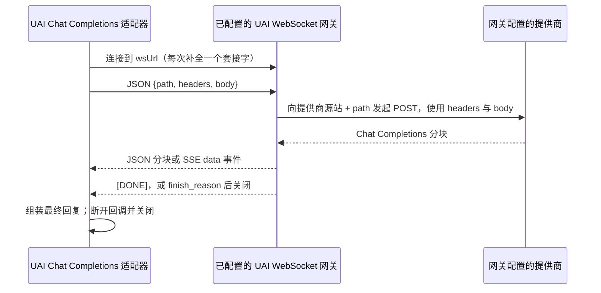

# 提供商兼容性与 WebSockets

适用于 **3.7.2**，2026 年 10 月 29 日。

UAI 实现了 **Chat Completions**、**Anthropic Messages** 与 **Google Gemini**，
并为受支持的 OpenCode 与 AgentRouter 模型额外提供了一条专用的 **Responses** 路径。自定义
提供商可以选择与之匹配的协议。这是协议层面的兼容性，并不保证每个模型、服务器版本、
账户或专有 API 都能正常工作。

兼容性检查使用合成的 HTTP 响应与套接字事件，无需运行中的模型、API 密钥或付费
推理。在线服务器的可用性、模型质量、工具调用准确性、执行器网络与 TLS 不在该
覆盖范围内。

## 提供商设置与模型发现

首次使用需要在推理或发现之前设置密码，或明确选择 **Continue without encryption**，
包括公共免密钥路由与内置免费路由。若使用密码库，每次执行都需要解锁，包括
`ui = false` 的嵌入式使用。已保存的不受保护存储选择会跳过后续的密码提示，并以
可逆的字节编码存储密钥。该前置校验会保留现有凭据以便经过验证的迁移；参见
[API 密钥安全](API_KEY_SECURITY.md)。

各[单独设置指南](providers/README.md)涵盖 Vercel AI Gateway、
Perplexity Orchestrator、FriendliAI Model APIs、Venice、Nscale、Arcee AI 与
AI/ML API。每份指南都列出确切的预设、账户/密钥要求、目录路由与已记录的限额。Vercel 的
免费额度仅适用于符合条件的模型；公共目录中同样包含付费模型。AI/ML API 文档所述的
免费额度目前处于暂停状态。

目录发现与推理鉴权和付费是相互独立的。若干提供商公开其目录，因此成功拉取并不能
验证密钥，也不代表可以访问返回的每一个模型。提供商编辑器与模型菜单
支持多词搜索；搜索为空后刷新与手动输入仍然可用。查询凭据不会出现在连接摘要
与加载文本中。

通用模型列表保留全部 ID。在四条确切记录的路径上，UAI 会读取
显式的 API 类型：AI/ML API `type: openai/chat-completions`、Vercel
`type: language`、FriendliAI `mode: chat` 与 Venice `type: text`。其他显式
类型会被省略，发现提示会报告隐藏了多少条。无类型的
条目与手动输入的 ID 仍然可用。这些规则不解释自定义主机、其他端口或不同 API 路径上的
厂商字段。Chat 兼容性仍然不能确立工具、视觉或推理支持。

Chat 与 Responses 请求默认最多保留 128 条工具声明。
当可用工具更多时，`uai_tool_catalog` 会公开其余名称、
其确切的 schema 页面与一个调用动作。原生调度器保留
原有的工具权限、作用域与执行回执。这取代了
此前使后续工具无法访问的截断。OpenCode 兼容性
声明仅为 OpenCode 路径保留。

## 响应速度与推理显示

新配置在受支持的推理模型上使用 Low 推理强度。更早保存的
选择仍然生效；选择 **Settings → Agent → Effort → Low** 即可更改
它们。更高的推理强度有助于困难任务，但可能延迟首次响应。
Provider default 会省略该字段；它并不会禁用思考。提供商的原始
参数可以覆盖推理强度设置，不受支持的模型可能忽略它。
模型弹窗会为已记录的模型以及任何启用了 **Options → Reasoning support** 的模型展示同一全局设置。已知的档位仍会被
夹取；启用未知模型并不能确立其可接受的推理强度档位。

不存在 5,999 token 的思考上限。保留的对话记录字段被限制在
24,000 字节以内，旧版显示会将其除以四来估算 token。被裁剪的
推理现在标注为 **Excerpt**。其他估算标注为 **tokens shown**：提供商
摘要与可见文本并不测量内部推理或计费用量。
回复额度、已知上下文窗口与提供商限额仍然适用。
实时回答预览与推理预览具有各自独立的限额标记，因此较长的回答
不会把本来完整的推理轨迹标为摘录。

固定的提示规则排在会变化的环境元数据之前，以便兼容的
提供商更多复用其提示缓存。实际的缓存使用与延迟
取决于端点。缓冲的执行器 HTTP 会在完成时投递响应；
UI 变更无法在投递前暴露 token。原生请求仍受
300 秒上限约束，无论配置的等待时间是否更长。已连接的 Cowork
推理没有整体客户端或桥接时限；其单次状态轮询
保持很短，Stop 始终可用。直接/伴生（companion）超时设置不会
缩短 Cowork 请求，旧的桥接超时设置已弃用。

桥接以增量方式读取提供商的 SSE，并把收到的增量推送到
浏览器。更新后的原生客户端在请求运行期间，还会通过桥接既有的
状态端点以大约一秒的间隔接收文本/推理预览页。游标可防止在轮询丢失后
文本重复。保留帧缺失或预览达到限额时，会留下带标注的摘录，
直到完整的最终结果到达。工具参数、Gemini 签名与用量从权威的
完整响应中解析。旧桥接与伴生程序保留其完整响应体
协议。缓冲响应永远不会获得人为的打字效果或预览重放。
中继等待者有自己的有界准入计数；只有真正的原生 HTTP
调用才占用原生连接槽位。本地桥接调用可以在其既有的短调用预算内
等待可用槽位。

流失败会保留提供商提供的错误码与消息，包括纯文本的
`event: error` 响应。详细信息会被脱敏并限长。
部分文本之后的错误仍会使请求失败；它不会导致重复的
套接字/HTTP 调度，也不会执行部分投递的工具调用。

## 模型价格与限额

2026 年 10 月 25 日的目录包含 15 个提供商的 1,760 条模型条目，
其中包括提供商特定的文本 token 价格与上下文/回复限额。
[Models.dev](https://models.dev/api.json) 提供主目录，包括
OpenCode 当前的免费模型限额；[LiteLLM](https://raw.githubusercontent.com/BerriAI/litellm/main/model_prices_and_context_window.json)
填补确切的提供商缺口。[OpenRouter](https://openrouter.ai/api/v1/models) 与
[Kilo](https://api.kilo.ai/api/gateway/models) 提供各自的路径价格。
[Cline 的促销源](https://api.cline.bot/api/v1/ai/cline/recommended-models)
为五个确切的免费 ID 确立零 token 费率；它并不发布其
上下文或回复限额。元数据用于补充发现的或手动输入的模型；
它不会提供端点未列出的模型。

Kilo 的 401 条目录条目仅适用于其支持的 HTTPS 网关路径。
没有显式免费标记的零价格占位符仍视为未知。Cline
的价格仅适用于其保留的桌面桥接路径，且桥接在每次请求前仍会
检查当前的免费可用性。促销与账户额度在此日期快照之后可能
发生变化。

价格为以美元计的每百万文本 token 估算值。已记录的缓存费率与
长上下文分层会应用于用量估算。特殊服务分层、请求费用、
图像/音频费用、税费与账户折扣不在这些估算之内。
未知的端点价格仍为未知，免费路径永远不会设定其
付费对应项的价格。内置的 Project UAI Free 访问成本为零；个人
HCNSEC 密钥并不能确立已知价格。

维护者用 `node tools/sync_pricing.js --refresh` 刷新，审阅
`tools/data/model_metadata.json`，然后用 `node tools/sync_pricing.js` 生成。
刷新可以通过 `--opencode-catalog <file>`
与 `--opencode-version <version>` 纳入经过清理的 CLI 目录。验证前先检查
`src/provider/model_data.lua`；`node tools/sync_pricing.js --check` 会离线检查新鲜度。
任何目录变更后都需重新构建客户端。

## 图像输入

来自 Web 桥接的 PNG、JPEG 与 WebP 附件会作为实际的图像
内容投递：Chat Completions 接收 `image_url` data URL，Messages 接收
base64 的 `image` 块，Gemini 接收原生 `inlineData`，而 OpenCode
Responses 路径接收 `input_image` 块。请选择支持视觉的模型与端点。纯文本
模型仍可用于不含图像附件的对话。

重新加载更新后的游戏客户端并重启更新后的桥接以启用该
能力。在 Game 与 Web 运行时中，携带图像的请求都使用桥接中继，
使图像字节不进入 Lua 与对话记录。桥接会在内存中保留
图像 15 个空闲分钟；删除、过期或重启后需要
重新附加当前图像。较早用户轮次中不可用的图像会被
替换为明确的文本提示，以便后续文本轮次继续。

## 本地服务器

这些普通 HTTP 连接请将 **Gateway socket URL** 留空。

| 服务器 / 预设 | 默认基础 URL | 鉴权 | 工具要求 |
| --- | --- | --- | --- |
| Ollama | `http://127.0.0.1:11434/v1` | 本地模型无需鉴权 | 支持工具的模型。UAI 会省略默认的 `tool_choice` 与 `parallel_tool_calls`；仍可显式覆盖。 |
| LM Studio | `http://127.0.0.1:1234/v1` | 默认无需鉴权；若启用服务器鉴权则用 Bearer | 合适的模型与聊天模板；支持情况因模型/运行时而异。 |
| vLLM | `http://127.0.0.1:8000/v1` | 默认无需鉴权；若配置了 `--api-key` 则用 Bearer | 聊天模板、合适的工具调用解析器，并在服务器上启用自动工具选择。 |
| llama.cpp | `http://127.0.0.1:8080/v1` | 默认无需鉴权；若配置了 `--api-key` 则用 Bearer | 兼容的模型/模板，通常配合 `--jinja`；解析器支持取决于模型。 |
| SGLang | `http://127.0.0.1:30000/v1` | 默认无需鉴权；配置服务器鉴权时用 Bearer | 模型的聊天模板与工具调用解析器。 |
| 其他兼容的服务器/代理 | 在 Custom endpoint 下填写其记录的基础 URL | 与服务器配置保持一致 | 必须实现受支持的协议，包括供智能体使用的工具结果回放。 |

本地预设标签并不决定可达性。UAI 会检查实际 URL：
回环地址、私有 IPv4/IPv6、`.localhost`、`.local` 与单标签主机都需要
执行器 HTTP 函数。在本地预设中填写的公网 URL 会被视为
公网；自定义的 localhost URL 会被视为本地。`localhost` 指的是
发出请求的那台机器。远程容器、虚拟机或局域网服务器需要其
可达的地址与端口。服务器的绑定地址如 `0.0.0.0` 不是
常规的客户端地址；请使用回环地址或它的实际接口地址。

在服务器运行后再拉取模型，或输入其确切的模型/部署 id。
UAI 不会杜撰模型名称。通用发现会保留嵌入 ID；Google 的
原生目录明确标识生成方法，因此那里会排除仅用于嵌入的条目。
普通文本回复并不能证明工具支持。智能体使用还需要模型
与上下文窗口足够大，能容纳所选工具与对话。

Ollama 原生的 `/api/chat` 与 `/api/generate`、OpenAI
Realtime、通用 Responses 端点、旧版 Completions、Bedrock 原生 API 以及其他专有
格式在本客户端中都不是适配器。请使用兼容的接口面或外部
适配器。已知不匹配的原生路径会产生可操作的诊断信息。

## 原生 Google Gemini

新的 **Google Gemini** 连接使用 `https://generativelanguage.googleapis.com/v1beta`，
采用 **Google Gemini** 协议与 `x-goog-api-key` 鉴权。既有的
指向 `/v1beta/openai` 的连接保留其已保存的 Chat Completions 协议与 Bearer
鉴权。原生发现最多跟进十页（10,000 条），移除
`models/` 资源前缀，并保留声明支持生成的模型。

该适配器发送原生系统指令、JSON Schema 函数声明、
并行函数调用与有序函数响应。它接受完整的 JSON
响应与 SSE，将推理摘要与回答文本分离，并统计
思考 token 与缓存输入 token。它会在任何返回的工具运行之前
拒绝不完整或失败的流。原生 HTTP 仍接收缓冲的响应体；桥接
流式则可以显示增量进度。这些路径不实现 Google 单独的
Live、Interactions、音频/视频生成或图像生成接口。

图像输入使用既有的会话所属桥接引用。桥接会在向提供商
发起请求之前立即将其替换为 `inlineData`；会话历史
不包含 base64 图片数据。Gemini 的已签名模型部件会按其确切的签名边界与
端点/模型作用域持久保存，以便恢复的工具交换
可以继续。来自其他模型或端点的签名永远不会被
重用。

已记录的 Gemini 3 与 Gemini 4 Argon 推理强度控制映射到原生 `thinkingLevel`；Gemini 2.5 使用
`thinkingBudget`。**Provider default** 会省略推理强度覆盖。Gemini 3 原生
请求会将 temperature 保持在 Google 推荐的默认值，除非显式设置；
已记录的 Gemini 3.6/3.7/3.8 Flash 与 Gemini 4 Argon 模型会省略不受支持的采样参数。
模型的 Temperature handling 控件可以显式选择 Auto、Send 或 Omit。
提供商的 `params` 与请求的 `extra` 接受诸如
`generationConfig.thinkingConfig` 的原生字段；最终输出上限仍然适用。

协议参考于 2026-10-17 审阅：

- [GenerateContent REST API](https://ai.google.dev/api/generate-content)
- [原生 API 发现 schema](https://generativelanguage.googleapis.com/$discovery/rest?version=v1beta)
- [Gemini 3 思考与 temperature 指南](https://ai.google.dev/gemini-api/docs/gemini-3)
- [Gemini 3.8 思考档位与参数变更](https://ai.google.dev/gemini-api/docs/whats-new-gemini-3.8)
- [Gemini 4 Argon 思考与参数指南](https://ai.google.dev/gemini-api/docs/latest-model)
- [思考与已签名响应部件](https://ai.google.dev/gemini-api/docs/thinking)

## 预设路由矩阵

每个目录预设在 `test/provider_compatibility.lua` 中的离线矩阵里都有一行：
其基础 URL、协议、鉴权头与两种请求形态都会在无在线模型的情况下
演练。下表只列出在目录基础 URL 下形态并非普通 Chat Completions 的
路径。其他所有预设都使用 Chat Completions，在请求体中发送配置的模型 id，
并在同一基础地址下发现模型。`/models` 不是必需的：当服务未暴露该接口
或密钥无法列出模型时，手动 id 仍然可用。

| 预设 | 基础路径 / 主机 | 协议 | 默认鉴权 |
| --- | --- | --- | --- |
| Project UAI Free (HCNSEC) | `api.hcnsec.cn/v1` | Chat Completions | Bearer |
| AgentRouter | `agentrouter.org/v1` | GPT：Responses；其他：所选协议 | x-api-key |
| Anthropic Messages | `api.anthropic.com/v1` | Messages | x-api-key |
| Google Gemini | `generativelanguage.googleapis.com/v1beta` | 原生 generateContent / streamGenerateContent | x-goog-api-key |
| Azure AI Foundry | `<resource>.openai.azure.com/openai/v1` | Chat Completions | api-key |
| Azure OpenAI（部署路径） | `<resource>.openai.azure.com/openai/deployments/<deployment>` | Chat Completions 加 `api-version` | api-key |
| OpenCode Zen | `opencode.ai/zen/v1` | Chat Completions；需要时走专用 Responses 通道 | Bearer |
| OpenCode Go | `opencode.ai/inference/go/v1` | 依模型而定：Chat、Responses、Messages 或 Gemini | Bearer |

其余预设涵盖 OpenAI、OpenRouter、DeepSeek、Groq、Cerebras、Mistral、
Together、Fireworks、DeepInfra、Hyperbolic、Nebius、Novita、SambaNova、Moonshot、
DashScope、SiliconFlow、Volcano Ark、Hunyuan、Qianfan、StepFun、Yi、Baichuan、
Spark、Upstage、Reka、AI21、Cohere 的兼容层、Hugging Face
router、Ollama Cloud、Baseten、Kluster、Chutes、Featherless、NanoGPT、Requesty、
Scaleway、RunPod、Kilo、LLM7、OVHcloud、ModelScope、Z.ai、NVIDIA NIM、GitHub
Models、Cloudflare Workers AI 与 Aion Labs。GitHub Models 不在其中，因为
该服务已于 2026 年 7 月 30 日停用；本地服务器在上文单独列出。上述每一项都是
在图库所示基础 URL 上的 Chat Completions。若某厂商已记录的 API
会被本客户端的基础 URL 规范化器错误路由，则该厂商不作为预设提供；它仍可通过
Custom endpoint 以其确切路径访问。

图库将预设分为免费、付费与本地三档，并在密钥尚不存在时
逐项描述。档位代表获取方式，而非能力：免费路径与付费
路径使用同一批适配器，成功列出模型也从不证明
账户、订阅或某个支持工具调用的模型可用。混合型服务——同时
具有免费与付费两半的服务——会被推荐并贴上其免费一半的
标签，而不会被称为付费：OpenCode Zen 标注了其免费的桌面 CLI 模型，
OpenRouter 标注了其免费模型 id，OpenCode Go 则将其订阅
与免费 CLI 目录分开。Project UAI Free 标注为 Included，因为其密钥
随客户端分发。

## 连接与响应行为

### Project UAI Free

新用户以及尚无提供商的配置会以 **Project UAI Free** 起步，
使用内置的公共 HCNSEC 访问及其经过验证的 `auto` 路由器。无需个人 API
密钥或模型条目。既有提供商与私有凭据保持
不变。之后可选择 **Use Project UAI Free** 添加它。感谢你持续
使用与支持 Project UAI；很快可能会有更多免费提供商推出。

内置社区访问的开放时间为**每日 20:00 至次日中午 12:00，固定 UTC+8（北京/新加坡）**。
客户端本地时区与夏令时不会改变这些时段。在时段之外，UAI 会说明下一次
开放时间，并跳过新的内置访问推理、模型发现与后台
探测。请选择其他提供商，或于 UTC+8 20:00 再回来。你仍然可以保存该
免费提供商；个人 HCNSEC 密钥不使用此社区时间表。已被接受
的推理可以在 12:00 之后完成。这些检查提供的是客户端指引；
实际可用性由服务控制，且服务必须执行任何服务端访问限制。

**Settings → Agent → Automatic free routing** 默认启用且为可选项。
将其关闭可停止后台测量，并在后续请求中保留所选提供商
模型。已接受的请求会按其既有路径完成。当 UAI
选择某个经过测量的模型时，对话提示会指出该模型并给出此设置路径。
当所选模型为 `auto` 时，提供商仍可能执行它自己的路由。

在开放时段内，启用自动免费路由、选择 `auto` 且
使用默认 Chat 设置时，UAI 会在你打开
模型选择器或发送智能体请求时在后台测量模型。它会发现
实时目录，检查一次小型工具调用及其结果回放，并优先选择
最快的已验证候选，其两次响应各在十秒内完成。
选择器会显示最新一次合成探测的时间。测量进行时，首次请求可以使用
提供商的 `auto`；打开选择器只是预热选择，
不会发送你的对话。两个工作线程最多检查 32 个已公布的 ID；
测量持续十分钟，并在连接/鉴权设置变更时失效。

所选模型必须具有已知的上下文窗口，且足以容纳准备好的
请求与回复。图像、未知上下文限制以及显式的提供商请求体、
查询或套接字设置会保留其既有路径。按名称选择模型或
使用个人密钥会使该选择固定下来。缓慢或失败的真实响应
会在后续选择中移除该候选；它永远不会启动
当前提示的副本。保存的选择器仍为 `auto`，按作用域记录的 API 限额
经验仍会持久保留。免费选项在模型菜单中带有绿色圆角边框。

**十秒是选择目标，而不是对真实请求的保证。** 更长的
提示、工具目录、推理与共享负载都可能耗时更久。原生探测
使用当前生效的直接/中继通道，且只包含一个合成的连通性工具；
它们从不执行该工具，也不包含对话数据。参见
[实测的 HCNSEC 结果](FREE_ROUTING_VALIDATION.md)。
共享容量会变化，因此请求可能很快、很慢、被限流或不可用。
帮助、可用性更新与社区新闻：https://discord.gg/9xYyyYuKap。

### OpenCode 桌面端与移动端

直接桌面端变通方案使用实时验证过的桌面 User-Agent/客户端
身份、基于时间戳的会话头与通配 Accept 头，不经过
桥接。必需的兼容性工具声明与 Chat/Responses 回退
会被保留。显式的自定义头仍然生效。桌面端遇到免费档拒绝时
仍可尝试一次 Responses。显式的协议拒绝
同样保留该回退。必需的声明在直接路径与较旧的桥接路径上
仍然存在。

桌面桥接为经验证的免费模型目录增加了一条可选的已安装 OpenCode CLI 服务器
路径。请单独安装 OpenCode；Project UAI 不
打包其二进制文件。参见[桌面端设置](../desktop/README.md)与
[实时模型验证](OPENCODE_3.2_VALIDATION.md)。桥接负责经过鉴权的
回环访问、临时会话与向 Roblox 的工具交接。CLI 模型发现
使用其经过鉴权的桥接能力；若缺少该能力，常规的直接
模型发现仍然可用。缺少 CLI 以及模型不在其公开目录内时，
保留既有的直接 HTTP 路径。

**移动端 OpenCode 需要来自 Discord 的 UAI Relay 应用**：安装并启动该
应用，然后在 UAI 中连接它。Project UAI Free 仍是
移动端兼容提供商的替代选择。移动端的免费档
拒绝不会重试 Responses 或代理。请在
[Discord](https://discord.gg/9xYyyYuKap) 分享错误并获取更新。

OpenCode 代理已弃用。已保存或输入的旧代理 URL 会迁移到
官方 Zen URL。历史成功的直接请求只是其主机与日期上的观测，
并不保证每个执行器或未来的上游版本都能工作。

### OpenCode Go 订阅

选择 **OpenCode Go** 并使用来自已订阅 OpenCode 工作区的密钥。其
规范基础地址为 `https://opencode.ai/inference/go/v1`；旧版
`https://opencode.ai/zen/go/v1` 别名保留 Go 路由。早先含义不清的代理
记录仍会迁移到 Zen，因此请显式选择 Go。Go 使用自己的模型列表，
即使在桌面免费 CLI 后端就绪时仍保持为带密钥的上游请求。
移动端免费模型限制不适用于付费 Go；原生移动端 Go
行为尚未验证。

| Go 模型系列 | API 路径 |
| --- | --- |
| DeepSeek | `/chat/completions` |
| GPT、Grok、Muse | `/responses` |
| Claude、Minimax、Qwen | `/messages` |
| Gemini | `/models/<model>:generateContent` 或 `:streamGenerateContent?alt=sse` |

受支持的系列会自动路由，而不改变已保存的 API 选择。
请求保留 Go 基础地址、所选密钥、查询参数、可识别的
`ProjectUAI/<version>` User-Agent 与稳定的 `x-opencode-session`；自定义头
仍为显式覆盖。独立的元数据目录提供已知限额；
Go 订阅成本不会从 Zen token 价格推断。

成功拉取公开的 `/models` 并不能验证密钥或订阅。
**active Go subscription required** 拒绝意味着 OpenCode 拒绝了该请求的订阅
访问：请检查密钥所属工作区及其订阅，若已生效
则联系 OpenCode 支持。**Global regions required** 拒绝指出了
该模型所要求的工作区 Privacy 设置；请在该 OpenCode 中复核该选择。
已弃用代理的 **410** 与 Go 订阅有效性无关。实际实时
结果及其限额见 [OpenCode 验证](OPENCODE_3.2_VALIDATION.md)。

### 自动的未授权客户端恢复

当官方 AgentRouter 端点明确返回
**unauthorized client** 错误时，UAI 会切换其 Base URL，并通过位于
其正式域名的 Project UAI 代理重试（不使用 Workers.dev 回退）：

| 提供商 | 恢复 Base URL |
| --- | --- |
| AgentRouter | `https://puai-proxy.davidzk.tech/agentrouter/v1` |

代理会接收相同的提供商密钥、请求与模型。所选协议、
自定义头与查询参数会保留，必需的厂商身份头
同样保留。在线提供商的新 Base URL 会被保存，并可
在 Providers 中继续编辑。未保存编辑器中的连接测试或模型拉取只会改变
该草稿，直到保存为止。重试状态会标示该切换。

该路径共享代理运营方声明的**每日 90,000 次请求**上限；
可用性取决于代理及其上游提供商。代理不会
改变账户权限、模型访问或提供商计费。无效密钥、
普通 401/403 响应、免费档/账户限制、HTML 质询与
传输故障都不会触发该恢复。只有显式的结构化错误
字段或简短的纯文本客户端拒绝才符合条件；成功的内容与流
错误无法重定向请求。

自动代理切换仅限于 AgentRouter 的官方 `/v1` 路径，
包括完整的推理 URL。自定义主机、
自定义路径与非标准端口保持不变。一次操作最多切换
一次，代理重试共享 HTTP 截止时间与取消状态。
进行中的编辑、已移除的提供商与过期的模型拉取无法覆盖新的
连接。已知代理路径使用 HTTP 或所选的 Web 中继；配置了
UAI 套接字网关时，它有自己独立的上游源，无法路由此代理切换。

### 通用连接规则

- 裸公网主机名会补上 `https://`，若无路径则补上 `/v1`。裸本地
  地址会补上 `http://`。显式 scheme 与自定义前缀会保留。
  IPv6 地址使用方括号。不支持的 scheme 与 URL userinfo 会被拒绝。
- 完整的 `/chat/completions` 或 `/messages` URL 可用，包括查询字符串；
  切换协议或发现模型会替换端点后缀。URL
  片段会被省略。额外的查询字段会覆盖同名的
  基础查询字段而不重复，其他基础查询值会保留。
- 鉴权风格是字面的：Bearer、x-api-key、api-key、两者或都不。原生
  Anthropic 预设选择 x-api-key；对 Messages 网关，显式的 Bearer 选择会得到
  尊重。密钥池在每次新的
  发现或推理请求时轮询就绪凭据。被限流的密钥在冷却期间会被跳过；
  代理恢复保留所选凭据。单个请求的传输重试
  保留该请求的密钥。缓存的模型列表不占用池槽位。
  较晚的头映射会以大小写不敏感的方式覆盖较早的名称。
- 已发现的 id 会按该连接/鉴权配置缓存十分钟。
  未保存的草稿相互独立。更改设置、使请求失效或启动更新的
  拉取，可防止较早的响应覆盖列表。HTTP 错误文档
  不会被视为成功的空模型列表。手动输入的模型仍排在首位。
- 当提供商编辑器的 URL、协议、鉴权、密钥或
  预设发生变化时，会清除已拉取的选项，包括在待处理拉取期间改走又改回。
  手动 id 仍然可用。选择预设会应用其身份默认值并清除
  上一个预设的网关 URL；本地预设会链接到服务器设置文档。
- JSON 与缓冲 SSE 使用同一个有界的 Chat Completions 组装器。文本、
  推理、用量与带索引的工具参数片段会被保留；整个参数
  对象会被序列化为 JSON。混合的对象/片段参数会显式失败。
  损坏或不完整的流不能变成成功的回复。
  缺少完成标记的诊断会指出预期的最终标记。来自其他协议的
  可识别事件会指出不匹配，并引导用户
  检查 Protocol 与 Base URL。部分文本与完整的工具 JSON 不能证明
  完成；`malformed_stream` 仍为终态，以避免推理重放。
- 明确的 400/422 参数拒绝可以教会有界的请求修复。FastAPI
  校验错误会暴露字段位置/消息，但不回显其 `input`。
  修复与学到的输出限制按端点、协议与模型区分；
  旧的无作用域经验在首次使用时采用当前配置。点明至少 512 token 的上下文
  拒绝会被识别，包括 2K/4K 本地模型。
  学到的上下文窗口沿用既有的全局、小写化模型 id 映射。
- HTTP 由 Roblox/执行器 API 缓冲。选择 SSE 并不会使该
  传输变为增量式。原生 HTTP/套接字请求的等待上限为 300 秒，
  响应预算为 8 MiB；主机/服务器可能施加更短的限制。
  已移除的 8,192 token 执行器上限不会在 HTTP 回退中回归。

## WebSocket 选项的确切工作方式

它是一个可选的 **UAI 网关协议**，而不是提供商的常规 HTTP API。
`bridge/` 或 `tools/` 中并不附带匹配的推理 WebSocket 网关。
可选的浏览器桥接使用自己的中继协议，是独立的传输方式。



1. 仅当生效的请求体带有 `stream: true`、设置了 `wsUrl`、存在执行器连接器
   且未选择 Web 中继时，适配器才会为 Chat Completions 使用套接字。发现仍走 HTTP。
   Messages 会忽略 `wsUrl`。
2. UAI 调用 `connect(wsUrl)` 时**不携带自定义升级头**。在 WebSocket 握手期间
   要求自定义 HTTP 鉴权头的网关不受此连接器支持。网关改在
   首条应用消息中接收提供商凭据。
3. UAI 发送一个 JSON 信封，例如：

   ```json
   {
     "path": "/proxy/v1/chat/completions?api-version=example",
     "headers": {
       "Authorization": "Bearer <provider-key>",
       "Content-Type": "application/json",
       "Accept": "text/event-stream"
     },
     "body": {
       "model": "server-model-id",
       "messages": [{"role": "user", "content": "Hello"}],
       "stream": true
     }
   }
   ```

   `path` 是完整的提供商路径与查询，不含源站。网关需要
   自行配置上游源站；UAI 不会为它选择该上游。
   头使用与 HTTP 相同的鉴权、自定义字段与必需身份。
   因此网关会看到提供商密钥、提示与工具。
4. 回复可以是单个 Chat Completions JSON 对象，也可以是 SSE 事件。SSE
   注释/元数据、CRLF、多行 data 以及跨套接字消息拆分/合并的事件
   都会被接受。不带空分隔符的完整单条 `data: {...}` 消息
   仍然受支持。每个被接受的块都会更新实时预览，并被
   保留用于最终组装。
5. `[DONE]` 结束该交换。在有效 `finish_reason` 之后关闭
   也算成功。在事件中途或完成前关闭、无效 JSON、提供商
   错误事件、回调失败与超出预算都会使请求失败。没有任何数据的流
   不算成功。
6. 连接/建立失败、调度前连接器不可用，或 `Send` 之前的连接
   截止时间，允许 HTTP 回退。进入 `Send` 之后，即使调用抛出异常，
   投递也可能已经发生：超时、取消、数据格式错误
   与提前关闭都是终态。它们不能通过 HTTP 或其他
   提供商静默重试。迟到的连接会被关闭而不发送；迟到的回调会被
   断开，无法更新对话记录。

限额为四个连接/发送工作线程与四个保留的活动连接，
每次尝试 1–300 秒（无超时直接调用时为 120 秒），
接收数据 8 MiB，每个 SSE/JSON 事件 1 MiB，200,000 条套接字消息/事件，
64 次工具调用，每次工具调用 256,000 参数字节。一次补全创建并
关闭自己的套接字；聊天不共享常驻连接。

OpenAI 已记录的 Responses WebSocket 模式则连接到 `/v1/responses`，
在连接期间完成鉴权，并发送 `response.create` 事件。其事件
schema 与连接状态都不同。Realtime 又是另一个 API。二者若无
适配器都无法接收上述 UAI 信封。

## 离线验证

实现与回归测试夹具在运行测试之前编写。
专项套件覆盖每个目录预设的路径/鉴权、JSON 与 SSE、
工具调用/结果回放、本地兼容性失败、模型服务与提供商编辑器中的
发现竞态、作用域修复、套接字分帧、清理以及
调度/回退边界。

```powershell
luajit test/provider_compatibility.lua
luajit test/provider_proxy.lua
luajit test/provider_transport.lua
luajit test/provider_editor.lua
node tools/test_native.js
```

完整的原生命令会重建 bundle、检查生成的产物、运行
主/专项测试套件与性能契约，然后用官方 Luau 编译。
结果与任何遗留限制记录在
[原生发布报告](NATIVE_COMPLETION.md)中。

已发布的协议参考查阅于 2026 年 9 月 25 日：

- [Ollama OpenAI 兼容性](https://docs.ollama.com/api/openai-compatibility)
- [LM Studio 兼容性](https://lmstudio.ai/docs/developer/openai-compat)、
  [工具](https://lmstudio.ai/docs/developer/openai-compat/tools) 与
  [鉴权](https://lmstudio.ai/docs/developer/core/authentication)
- [vLLM 在线服务](https://docs.vllm.ai/en/latest/serving/online_serving/)
- [llama.cpp 服务器文档](https://github.com/ggml-org/llama.cpp/blob/master/tools/server/README.md)
- [SGLang OpenAI 兼容 API](https://docs.sglang.io/docs/basic_usage/openai_api_completions.md)
- [OpenAI Responses WebSocket 模式](https://developers.openai.com/api/docs/guides/websocket-mode)
